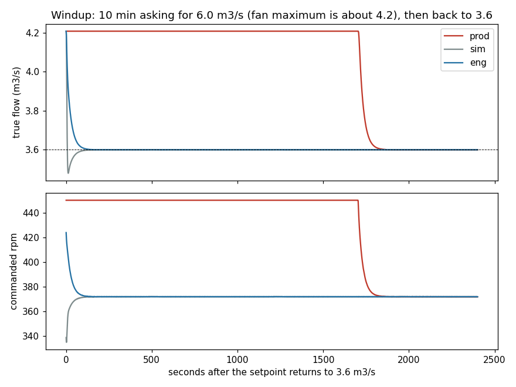
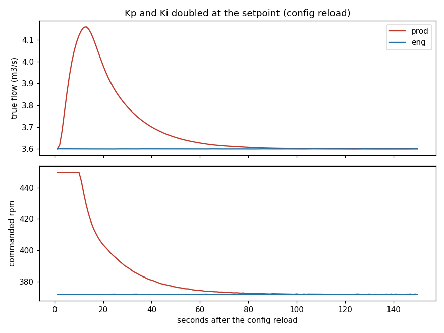
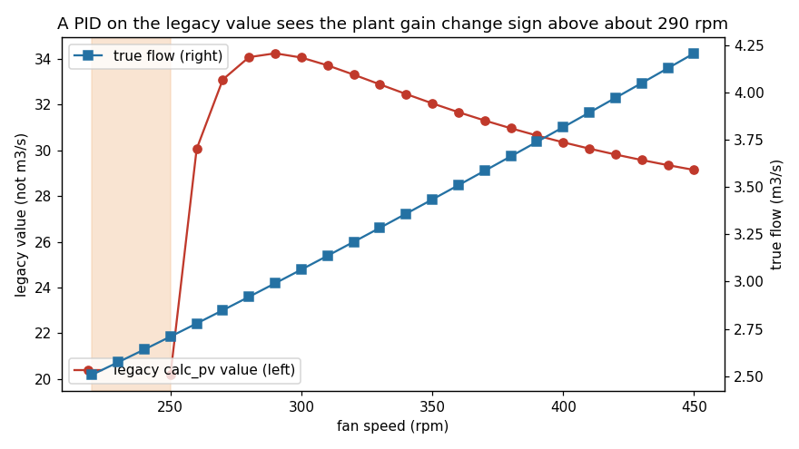

# PID and fan: edge cases, what the current control loop implies, and an engineering-units redesign

Generated 2026-11-17 from `sim/pid_edge_cases.py` (rerun: `python -m sim.pid_edge_cases`; figures:
`make_figures('project/pid-fan-report')`; pinned by `tests/sim/test_pid_edge_cases.py`, 37 tests).
Scope is the PID, the fan drive and the command path only. The plant, chimney and plate are in
`simulation-report.md`.

> **Read this first.**
> * Every plant value is a **placeholder** (`simulation-report.md`, top). Trust directions and relative sizes, not
>   absolute flows or rpm.
> * `fan-ctrl/main.py` cannot run without a PLC, so the "prod" rows below are a **re-implementation of main.py's
>   control logic** driving the real `PIDController`, `FanDrive` and `Command` classes. The main.py findings in §2 were
>   checked by reading the file and by calling the expressions it uses.
> * Under the 2026-11-14 architecture the PID moves into the PLC. This code still matters as the behaviour today, as
>   the simulation controller, and as the reference for what the PLC PID block must be set to do (§6).

## 0. Summary

Ranked by how likely each is to hurt on site.

| # | Finding | Evidence |
|---|---|---|
| 1 | **The daemon cannot run PID at all.** `main.py:85` reads `plc.FlowData.q_avg` (the class, not `kiln_plc.data`); `FlowData` is a dataclass with no defaults, so this raises `AttributeError` on the first PID scan and kills the DAQ thread. The stubbed PLC hides it until the first PID command. | §2.1 |
| 2 | **The PID setpoint never comes from the command.** `PID <sv>` is parsed but `cmd.value` is used only for MAN. The PID follows `config.set_point` (default 34, legacy units), applied after the next 60 s config reload. | §2.1 |
| 3 | **The PID's input is the legacy `calc_pv` value, and it is not monotonic in fan speed.** It peaks near 290 rpm and falls above that. In the upper range the loop has positive feedback: setpoint above the value pins the fan at 450 rpm, below it drops to the minimum. | §3.5, figure 3 |
| 4 | **No anti-windup.** 10 min asking for more than the fan can give costs about **29 min** of overspeed afterwards. The GUI simulation hides this because it patches the PID from outside. | §3.1, figure 1 |
| 5 | **NaN, None and empty input break the control path.** An empty or `None` command string raises an exception `parse_cmd` does not catch; `PID nan` is accepted; a NaN speed reaches `FanDrive`, which commands **maximum speed**; one NaN in the PID poisons it until `reset()`. | §4 |
| 6 | **Changing gains, switching mode or recovering from a fault kicks the fan.** Doubling Ki alone jumps the fan about 78 rpm and moves flow 15 %. | §3.2 to 3.4 |
| 7 | **OFF commands 0 rpm**, against the "Pi never stops the fan" rule. | §3.3 |
| 8 | Setpoints below about 2.7 m³/s are not met: the controller believes it is at setpoint while the true flow is up to 27 % higher. | §3.6 |
| 9 | A 5 Pa error on P1 or P2 moves the true flow about 8 %. Calibration, not control, limits accuracy. | §3.7 |

What is **fine**: on a plain step the current loop is overdamped, with no overshoot and about 50 s to settle. It is
insensitive to scan interval (0.2 to 5 s) and the plant gain varies only about 17 % across weather and speed, so gain
scheduling is not needed (§3.8).

## 1. What was run

* `pytest tests/sim`: 337 passed before the new tests; the new file adds 37.
* Three controllers on the same plant, same noise seed, same instruments:
  * **prod**: main.py's logic. No output clamp, no anti-windup, no bumpless transfer, no reset on mode change, OFF = 0 rpm.
  * **sim**: `sim.loop.ClosedLoop` as the GUI runs it. Patches the PID through its private `_integral`.
  * **eng**: a prototype written in engineering units (§5), same effective gains as prod.
* Direct calls into `PIDController`, `FanDrive` and `Command` with awkward numbers (§4).

## 2. What the control loop does today

### 2.1 Code-level findings (main.py, plc.py, config.py)

| Finding | Consequence |
|---|---|
| `pid_ctrl.compute(plc.FlowData.q_avg, ...)` | `AttributeError` at runtime (checked). Should be `kiln_plc.data.q_avg`. |
| `cmd.value` used once, in the MAN branch | `PID 3.6` and `PID 40` do the same thing. The setpoint is `config.set_point`. |
| `set_output_percent(pid_out)` gets the raw PID output | See §3.1 and §4.2: no clamp, and the argument is a **fraction** while the method name says percent. |
| `fan_drive_ctl.off()` | Commanded rpm 0. The PLC loses the speed reference. |
| No `pid_ctrl.reset()` on mode change | Stale integral on MAN→PID and OFF→PID (§3.3). |
| `parse_cmd` catches `ValueError` only | Empty, blank or `None` command kills the thread (§4.3). |
| Config reload every 60 s applies new gains, setpoint and command | An operator change takes up to 60 s to act; new gains meet the old integral (§3.4). |
| `next_time += scan_interval` never resynchronises | After a stall the loop runs back to back with a tiny `dt`; the derivative term spikes (§4.1). |
| `write_watchdog()` sets `com_ok = True` | Hides a lost link. |
| Config defaults: `kp = ki = kd = 0`, `pid_min_rpm = motor_min_rpm = 0`, `set_point = 34.0` | A default install commands a constant minimum speed, and 0 rpm is reachable, which includes the 150 to 210 rpm resonance band. |
| PV is the legacy `calc_pv` value (about 31 at the site point) | Gains are in "fraction per legacy unit", so a gain written for m³/s is wrong by orders of magnitude, and see §3.5. |

### 2.2 Effective gains in engineering units

The simulation's defaults (`kp 1.5`, `ki 0.2`, `span 8 m³/s`, PID range 220 to 450 rpm) are, as physical gains:

| Quantity | Value | Formula |
|---|---|---|
| Kp | **43.1 rpm per m³/s** | `kp / span × (pid_max − pid_min)` |
| Ti | **7.5 s** | `kp / ki` |
| Plant gain (flow per rpm) | 0.0067 to 0.0079 (m³/s)/rpm | measured, §3.8 |
| Proportional loop gain Kp·Gp | 0.29 to 0.34 | |
| Integral loop gain Ki·Gp | 0.038 to 0.045 per s | |

The same `kp = 1.5` with the daemon's default PID range 0 to 450 rpm is a Kp of **84 rpm per m³/s**: the gain
changes with an unrelated range setting, and with `flow_span`. That hidden coupling is the reason to configure in
physical units (§5).

## 3. Closed-loop edge cases

All times in seconds of simulated time, noise off unless stated. Setpoint 3.6 m³/s unless stated.

| Case | prod | sim (GUI) | eng (prototype) |
|---|---|---|---|
| **Windup high**: PID 6.0 for 600 s (fan max about 4.2), then 3.6. Time to get back within 5 % | **1740 s** | 6 s | 27 s |
| **Windup low**: PID 1.0 for 600 s (below natural draft), then 3.6 | 232 s | 39 s | 43 s |
| **MAN 300 → PID**: fan jump on the first PID scan | **57 rpm** | 0 | 0 |
| **PID → OFF**: commanded rpm / true flow | **0 rpm / 1.61 m³/s** | 380 / 3.66 | 380 / 3.66 |
| **P1 wire break 120 s, then recovery**: peak flow deviation | **10.4 %** | 1.8 % | 1.8 % |
| **Kp and Ki doubled at setpoint**: rpm jump / peak flow deviation | **78 rpm / 15.5 %** | 78 / 15.5 % | **0.03 / 0.01 %** |
| **Plain step 3.2→3.8**: settle / overshoot | 49 s / 0.01 % | 48 / 0.01 % | 48 / 0.01 % |
| **Same step with kd = 1**: fan jump on the first scan | **47 rpm** (29 without kd) | 47 | 26 |

### 3.1 Windup

The positional PID keeps integrating while the fan is at its limit. After 600 s at a setpoint of 6.0 the integral
term alone is worth about 24 times the whole 0 to 1 output range. When the setpoint returns to 3.6 the error is only
−0.075 (normalised), so the integral drains at 0.075 per s and the fan stays at 450 rpm for **29 min** (figure 1).
A realistic trigger: a setpoint typed too high, a cold-start with a closed damper, or a fan limit reached by
a weather change. The "sim" line is flat only because `ClosedLoop._anti_windup` edits `pid._integral` from
outside; the daemon has no such code. The low-side case is milder (232 s) because the fan is held at the minimum,
not driven against a hard limit.



### 3.2 Gain change on a config reload

At the setpoint with the output at 65 %, doubling Ki makes `ki × integral` jump from 0.65 to 1.30. The fan goes to
maximum, flow overshoots 15 % and takes a minute to settle (figure 2). Any edit of Ki on the dashboard does this.
The cause is that the integral is stored as an area (error × seconds) and multiplied by the gain, so a gain
change rescales the output. Storing the integral term in output units (rpm) removes it (eng: 0.03 rpm).



### 3.3 Mode changes

* **MAN → PID:** `compute()` starts with `integral = 0`, so the first output is `kp × error` alone, about 243 rpm
  when the fan was at 300. The fan drops 57 rpm and flow dips before the integral rebuilds it. A bumpless
  start (§5) removes the jump.
* **PID → MAN → PID:** the integral from the last PID session is reused (no reset), so the first scan after
  returning is wrong by whatever it held.
* **OFF:** 0 rpm. The fan coasts down through the 150 to 210 rpm band (2 s inside it here) and flow falls to the
  natural-draft 1.61 m³/s. The architecture says the Pi never stops the fan; OFF should mean the safe speed.

### 3.4 Sensor fault and recovery

The PLC holds a safe speed while a channel is faulty; the PID is not run. When the sensor returns, `dt` is the
whole fault duration (120 s here), so the integral takes one 120 s step of whatever the error is at the safe speed.
Result: a 66 rpm jump and a 10.4 % flow excursion, against 1.8 % with a controller that discards a stale interval
and starts from the current speed.

### 3.5 The input is a non-monotonic number

The daemon controls on `calc_pv` (the legacy value, not m³/s). Against fan speed (figure 3):

| rpm | 260 | 280 | 300 | 320 | 340 | 360 | 380 | 400 | 420 | 440 |
|---|---|---|---|---|---|---|---|---|---|---|
| legacy value | 30.1 | 34.1 | 34.1 | 33.3 | 32.5 | 31.7 | 31.0 | 30.3 | 29.8 | 29.3 |
| true flow m³/s | 2.78 | 2.92 | 3.06 | 3.21 | 3.36 | 3.51 | 3.66 | 3.82 | 3.97 | 4.13 |

Below 250 rpm the value cannot be computed at all. The value rises with the fan up to about 290 rpm and **falls**
above it, while the true flow rises throughout. A PID with positive gain therefore has the wrong sign on the upper
branch, where the site's 380 rpm operating point sits. Measured with the real `PIDController` on the legacy value
(warm start at 380 rpm, noise off):

| setpoint (legacy units) | fan after 900 s | legacy value | true flow |
|---|---|---|---|
| 33 (above the 31.0 start) | **450 rpm, pinned** | 29.1 | 4.21 m³/s |
| 29 (below the start) | **220 rpm, value then unavailable** | none | 2.51 m³/s |

Either setpoint runs away from where the operator wanted it. This is the strongest reason to control on a quantity
that is monotonic in flow. The legacy value stays untouched for display and logging, as the repo rule requires
(`calc_pv` is not edited). **Needs your decision:** control on m³/s computed from ΔP (what the simulation does), on ΔP
itself, or on the legacy value with the sign problem accepted.



### 3.6 Setpoints in the unreadable region

The 0 to 250 Pa transmitters cannot read suction. Both P1 and P2 sit at or below zero at low speed, so the plate ΔP
is under-read and the flow estimate is low. The loop drives the estimate to the setpoint and the true flow ends up
higher (noise off, no hunting seen):

| setpoint m³/s | 2.0 | 2.4 | 2.6 | 2.7 | 2.8 | 3.0 |
|---|---|---|---|---|---|---|
| true flow at the end | 2.55 | 2.60 | 2.63 | 2.70 | 2.80 | 3.00 |
| error | +27 % | +8 % | +1 % | 0 | 0 | 0 |
| fan rpm | 226 | 234 | 238 | 249 | 263 | 291 |
| transmitters saturated | yes | yes | yes | no | no | no |

Below about 2.7 m³/s (about 245 rpm) the setpoint is silently not met and the flow display agrees with the setpoint.
I did not test hunting with noise on in this range; the earlier report says the fan hunts there.

### 3.7 Transmitter offsets

The loop holds its estimate, so an offset moves the true flow. Steady error at setpoint 3.6 (plate ΔP is about
32 Pa):

| fault | true flow error |
|---|---|
| P1 +5 Pa / −5 Pa | −8.3 % / +7.6 % |
| P2 +5 Pa / −5 Pa | +7.6 % / −8.3 % |
| T +20 °C / −20 °C | −2.4 % / +2.6 % |

Neither pressure fault is detected. Better tuning does not fix this; it needs calibration checks and a
plausibility check (§6).

### 3.8 What is not a problem

* **Scan interval 0.2 / 1 / 5 s:** settle 48 / 48 / 50 s. No gain from scanning faster, none lost at 5 s.
* **Plant gain across weather and speed** (10 to 40 °C, 260 to 420 rpm): 0.0067 to 0.0079 (m³/s)/rpm. Loop gain
  varies 17 %. **Gain scheduling is not needed**; I earlier considered it and the data does not support it.
* **Resonance band in MAN:** a reference of 180 rpm is held at 210 (the band edge); crossing the band from 100 to
  300 rpm takes 1 s inside it. This models the drive's skip function, which is the protection. `FanDrive` itself
  knows nothing of the band and will command 180.
* **Noise:** with 3 Pa transmitter noise the fan speed has a standard deviation of 12 rpm at kd = 0, 28.5 at kd = 2
  (largest single-scan step 60 / 178 rpm). The prototype's filtered derivative-on-measurement gives 10.8 / 15.2 rpm
  (steps 53 / 81). **Do not use kd** with the current structure; with the prototype a small Td is affordable but
  gains little. Flow filtering (`q_average_count`) does more.

## 4. Unit-level edge cases (real classes, direct calls)

### 4.1 `PIDController`

| Input | Result |
|---|---|
| `dt = 0` (same timestamp twice) | Derivative skipped; fine |
| Clock steps back 60 s | `dt < 0`; the integral **decreases** |
| First call after a 1 h gap | Integral adds 3600 × error; output 108 |
| `dt = 1e-6` with a 0.01 error change, kd = 1 | Output **−9999.9**. Reachable after any scheduling stall (back-to-back catch-up scans) |
| PV is NaN | Output NaN, integral NaN **permanently** (a healthy PV afterwards still returns NaN); only `reset()` recovers |
| PV is `None` | `TypeError` |
| PV is +inf | NaN, same as NaN |
| Setpoint step with kd = 1 | Derivative kick of 0.15 (15 % of the range) on the next scan |
| 600 s at error 0.2, output saturated | Integral 119.8, worth 24 on a 0 to 1 range |
| Ki doubled at 65 % output | Output 0.65 → 1.30 |

### 4.2 `FanDrive`

| Call | demanded / commanded rpm |
|---|---|
| `set_output_percent(0.5)` | 335 / 335 |
| `set_output_percent(50)` (what the name suggests) | **11720 / 450** |
| `set_output_percent(-0.4)` | 128 / 220 |
| `set_output_percent(27)` (wound-up integral) | 6430 / 450 |
| PID range 100 to 300, motor range 220 to 450, output 0 | 100 / 220 (ranges silently disagree) |
| `motor_min 450 > motor_max 220`, `set_rpm(300)` | 220 (max wins; `conf_validate` catches this at load) |
| `set_rpm(None)` | `TypeError` |
| `set_rpm(NaN)` and `set_output_percent(NaN)` | **450**: a NaN reaches the drive as **maximum speed** |
| `off()` | 0 |
| `set_rpm(180)` with `motor_min 0` | 180, inside the resonance band |

The NaN case is the one to worry about: `min(450, max(nan, 220))` evaluates to 450 because of how Python orders
comparisons with NaN. A failed calculation upstream (a square root of a negative, a stale buffer) should land on a
safe speed, not the top speed.

### 4.3 `Command` and `parse_cmd`

| Text | Result |
|---|---|
| `""`, `"   "` | `IndexError`, **not caught**; the daemon thread dies |
| `None` | `AttributeError`, **not caught** |
| `PID nan`, `PID inf`, `PID -5`, `PID 0` | Accepted |
| `PID 3.6 junk`, `OFF now` | Accepted (extra words ignored) |
| `MAN -50`, `MAN 99999` | Accepted (clamped later by `FanDrive`) |
| `MAN 300.5`, `MAN 1e3` | `ValueError` → OFF (an operator typing a decimal rpm turns the fan off) |
| `PID`, `PID abc`, `STOP` | `ValueError` → OFF |

The dashboard writes `cur_cmd` as free text, so a blank field is plausible.

## 5. A better loop, in engineering units

The prototype in `sim/pid_edge_cases.py` (`EngPID`, 70 lines) is a sketch to measure the benefit, not a drop-in
replacement. It is what the table in §3 labels **eng**.

### 5.1 Units

| Quantity | Today | Proposed | Why |
|---|---|---|---|
| Process variable | legacy value, unitless | **m³/s** (or Pa of plate ΔP) | monotonic in flow; the operator's unit |
| Setpoint | `config.set_point`, legacy units | **m³/s**, from the command | one number, one unit |
| Output | fraction of the PID range, passed to `set_output_percent` | **rpm** | what the drive takes |
| Kp | per unit PV, per fraction of range | **rpm per m³/s** | independent of `flow_span` and the range |
| Ki | per second, same scaling | **Ti in seconds** | readable against the process lag |
| Kd | same | **Td in seconds** | |
| Time | wall clock difference | monotonic `dt`, validated | §4.1 |
| Rate | none in software | **rpm per second** | the drive ramp is 60 rpm/s |
| Gas temperature | °C in sim, K in `calc_pv` | state K or °C in the name (`t_gas_c`) | open item in `CLAUDE.md` |

Conversion from today's numbers: `Kp = kp / span × (pid_max − pid_min)`, `Ti = kp / ki`, `Td = kd / kp`. Defaults
become 43.1 rpm per m³/s, 7.5 s, 0 s.

### 5.2 Structure (what each piece fixed in §3)

* Output limited to the motor range, with **back-calculation** anti-windup (integral corrected by the difference
  between limited and unlimited output, tracking time = Ti). Windup high 1740 s → 27 s.
* Integral stored in **rpm**, not error × seconds. Gain changes no longer move the output (78 rpm → 0.03 rpm).
* **Bumpless transfer** on entering PID or leaving a fault: integral is set so the first output equals the current
  speed (MAN→PID jump 57 → 0 rpm).
* **Time-gap guard:** a `dt` outside (0, 5 s] is not integrated (fault recovery 10.4 % → 1.8 %).
* **Derivative on the filtered measurement:** no kick on a setpoint step (26 vs 47 rpm), less noise (§3.8).
* **Non-finite measurement holds the last output** and the caller escalates to the safe speed.
* Tuned for a measured step response (§6), not by guessing.

On a plain setpoint step the prototype and the current loop are the same (48 s settle, no overshoot). This is a
robustness change, not a performance change: the existing loop is well tuned for the happy path and unsafe on the
edges.

## 6. Recommendations

Split as the deployment model requires: **D** = fully testable on the dev machine, **H** = needs hardware to confirm.
Nothing below has been changed in `fan-ctrl/`.

| Pri | Change | D / H |
|---|---|---|
| P0 | Fix `plc.FlowData.q_avg` → `kiln_plc.data.q_avg` (§2.1) | D |
| P0 | Take the PID setpoint from `cmd.value`; stop using `config.set_point` for PID, or define the relationship | D |
| P0 | `parse_cmd`: catch every parse exception; reject non-finite, non-positive, out-of-range and trailing-junk values; fail to the safe speed, not OFF=0 | D |
| P0 | `FanDrive` and `PIDController`: refuse NaN/inf/None, fall back to the safe speed (never 450) | D |
| P0 | OFF means safe speed, not 0 rpm | D (architecture) / H (PLC action) |
| P1 | Output limits, back-calculation anti-windup, rpm-unit integral, bumpless transfer, `dt` guard (§5.2) | D |
| P1 | Decide the controlled variable (§3.5): m³/s from ΔP is monotonic and matches the simulation | D after your decision |
| P1 | Reset or track the PID on mode change and on a config reload that changes gains | D |
| P1 | Raise `motor_min_rpm` to the lowest readable speed, or clamp the setpoint at about 2.7 m³/s, until the plate/transmitter range is revisited | D / H (confirm on site) |
| P2 | Resynchronise `next_time` after a stall | D |
| P2 | Plausibility checks: P1 > P2, ΔP in range, T in range, flow rate of change | D |
| P2 | Filter the flow (`q_average_count`) rather than adding derivative | D / H (noise on site) |
| P2 | Config validation: default config must not be reachable into the resonance band; `pid` range inside `motor` range | D |
| P3 | Step-test the real plant in MAN (one rpm step, log flow) to identify gain, lag and dead time, then pick Kp and Ti with an IMC rule | H |

**When the PID moves into the PLC** (2026-11-14 architecture), this list becomes a checklist for that block: check
its manual for output limiting and integral-stop-at-limit, bumpless manual↔auto, derivative on PV, whether gains are
entered as gain or proportional band, and the units of Ti and Td and the sample period. The Pi side then reduces to
supplying a good flow value and a heartbeat, and its job is items 1 to 4 of the list above (the flow must be finite,
in range and monotonic).

## 7. Limits of this analysis

* Placeholder plant (`simulation-report.md` §3 and §10). Absolute times and rpm will differ on site.
* The windup, kick and gap numbers scale with the placeholder setpoint ranges but their existence does not.
* The legacy-value loop used arbitrary gains (0.05 / 0.005 per legacy unit) because none exist; the run-away follows
  from the sign of the curve, which does not depend on the gains.
* "prod" is main.py's logic re-implemented, not main.py. The thread-death results (§2.1, §4.3) are from calling the
  exact expressions, not from running the daemon.
* The prototype's tuning is the current gains converted to physical units; it was not optimised.
* Not covered: hunting with noise below 2.7 m³/s, concurrent config writes from the dashboard, and the PLC-side
  fallback table.

## 8. Reproduce

```bash
source .venv/bin/activate        # Windows: .venv\Scripts\activate
python -m sim.pid_edge_cases     # prints every number above
python -c "from sim.pid_edge_cases import make_figures; make_figures('project/pid-fan-report')"
pytest tests/sim/test_pid_edge_cases.py     # about 2 min
```
