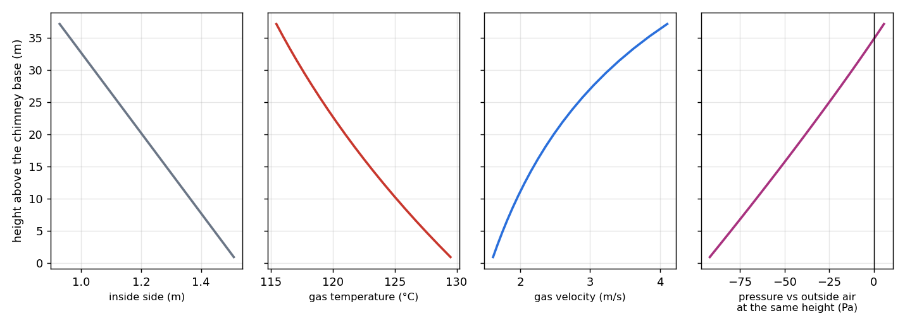
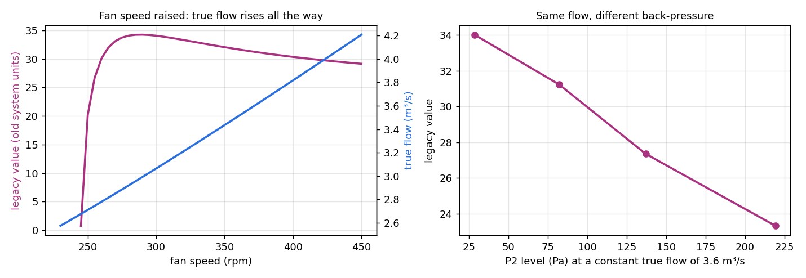
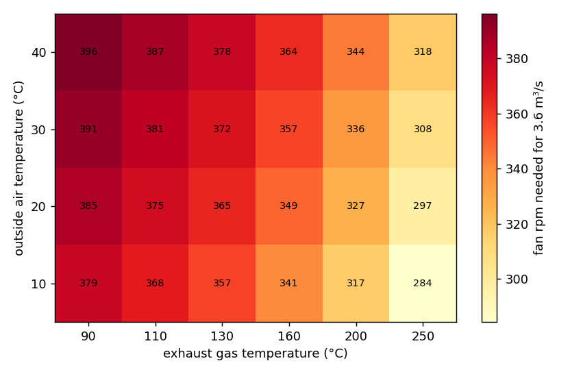
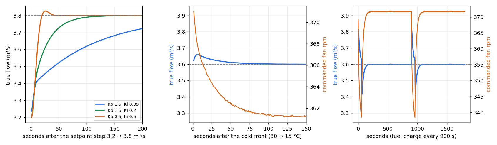

# How the parameters affect each other — kiln process simulation report

Generated 2026-11-17 by `python -m sim.report` from the simulation in `sim/` (natural draft, fan,
orifice plate and tapered chimney, with the real `fan-ctrl` PID in a closed loop). Rerun it after changing the model
or the defaults and the numbers below update.

> **Read this first.** Parameter values are **placeholders**, except the chimney dimensions given by the owner
> (125 ft tall, 5 ft square at the base, 3 ft square at the top) and the values tuned to one site reading (§3).
> Trust the **directions, the relative sizes and the interactions**. Do not quote flows, pressures or rpm as
> predictions for the real kiln. §9 lists what the model leaves out.

## 1. The system being modelled

The orifice plate sits **between the fan and the chimney** (owner, 2026-11-16). Heat reuse inside the kiln is not
modelled.

```
 kiln and flues ──► FAN ──► short duct ──► ORIFICE PLATE ──► restriction ──► chimney ──► outside air
 (resistance, as              (adds          P1 | P2, T        (loss seen     (buoyancy =      (pressure falls
  a free area)                 pressure)                        on site)       natural draft)    with height)
```

Default operating point: exhaust gas 130 °C, 30 °C outside.
**Natural draft alone moves 1.61 m³/s** (98 Pa of draft). Between its minimum
(220 rpm) and maximum (450 rpm) speed the fan lets the loop hold
**2.51 to 4.21 m³/s**. The default setpoint of 3.6 m³/s needs about **372 rpm**.

## 2. How the pieces connect

The model finds the flow from one pressure balance: **flow = √(total push ÷ total resistance)**.

* Push: kiln gauge pressure + natural draft + fan.
* Resistance: kiln and flues, fan-to-plate duct, plate (permanent loss), restriction, chimney friction, chimney exit.

Consequences that explain most of what follows:

1. **The fan and the draft add as pressures, but flow goes as a square root.** The more draft there already is, the
   less extra flow the same fan speed buys (§6.1).
2. **The plate is on the fan's discharge side.** P1 and P2 are negative when draft dominates and positive when the
   fan pushes. The site transmitters read 0–250 Pa only, so they are blind at low fan speed (§4).
3. **The plate signal is ΔP ∝ flow²**, so the resolution gets coarse at low flow (§6.5).
4. **The controller never sees the true flow**, only a value built from P1, P2 and T (§5, §6.6).

## 3. Check against the one real operating point

LabVIEW screen, 17-03-2026: P1 119.2 Pa, P2 87.0 Pa, exhaust 130.4 °C, fan 380 rpm.

|  | site | model at the same speed and temperature |
|---|---|---|
| P1 (Pa) | 119.2 | 120.9 |
| P2 (Pa) | 87.0 | 88.3 |
| Plate ΔP (Pa) | 32.2 | 32.6 |
| True flow (m³/s) | not known | 3.66 |

The match was obtained by choosing four placeholder values, so it is a **fit, not a confirmation**: duct and plate
size (to give the measured ΔP at a believable flow), fan curve (about 300 Pa at 380 rpm, as the
VelKilnMaster cold-start model assumes), kiln free area, and one more that needs explaining.

**The restriction.** A 38.1 m chimney at 130.4 °C gives about 106 Pa of
draft. With only the chimney after the plate, P2 would be **-115 Pa** (suction). The site shows
**+87 Pa**. About 200 Pa is being lost between the plate and the chimney top,
while the chimney as given accounts for 11 Pa (friction
3.3, exit 8.0). The model carries this as an equivalent opening
of 0.17 m² (`restriction_free_area_m2`). Possible causes, to be checked on site:

1. 3 ft and 5 ft are **outside** dimensions. An inside top of about 1.4 ft
   square would lose this much on its own.
2. A damper, bend, long flue or soot between the plate and the chimney.
3. Strong cooling in the chimney, so the real draft is well below 106 Pa.
4. P2 is tapped somewhere other than just after the plate.

Where the push goes at this point:

| pushing | Pa | resisting | Pa |
|---|---|---|---|
| natural draft | 106 | kiln and flues | 178 |
| fan | 300 | fan-to-plate duct | 1.2 |
|  |  | plate (permanent loss) | 16.1 |
|  |  | restriction | 200 |
|  |  | chimney friction + exit | 11.3 |

Other figures at this point: 11.4 t/h of gas; 3.0 m/s in the duct,
6.1 m/s through the plate bore, 4.2 m/s at the chimney exit;
fan air power 1.10 kW (about 1.8 kW at the shaft with the placeholder
efficiency); the gas carries 348 kW above ambient and loses 52 kW
through the chimney wall, leaving at 116 °C. Natural draft supplies 26 % of the push.



Outside air pressure at the chimney top is 434 Pa below ground level
(1.159 against 1.164 kg/m³). The draft exists because the hot gas inside
(0.890 kg/m³ at the top) is lighter still.

## 4. What the fan does across its range, and what the transmitters can see

| fan rpm | flow m³/s | draft Pa | fan adds Pa | fan inlet Pa | P1 Pa | P2 Pa | plate ΔP Pa | readable? | legacy value |
|---|---|---|---|---|---|---|---|---|---|
| 0 | 1.61 | 98 | -20 | -34 | -54 | -61 | 6.3 | **no** | – |
| 150 | 2.08 | 101 | 30 | -58 | -28 | -39 | 10.5 | **no** | – |
| 220 | 2.51 | 103 | 87 | -84 | 3 | -12 | 15.3 | **no** | – |
| 260 | 2.78 | 104 | 130 | -103 | 27 | 8 | 18.8 | yes | 30.1 |
| 300 | 3.06 | 105 | 180 | -125 | 54 | 31 | 22.8 | yes | 34.1 |
| 340 | 3.36 | 106 | 237 | -150 | 86 | 58 | 27.5 | yes | 32.5 |
| 380 | 3.66 | 106 | 301 | -178 | 121 | 89 | 32.6 | yes | 31.0 |
| 420 | 3.97 | 107 | 372 | -210 | 161 | 122 | 38.4 | yes | 29.8 |
| 450 | 4.21 | 107 | 430 | -235 | 193 | 150 | 43.1 | yes | 29.1 |


* A stopped fan is a small restriction (-20 Pa), not a blockage: natural draft still moves 1.61 m³/s.
* **Below about 245 rpm (2.67 m³/s) P2 is under suction and a 0–250 Pa transmitter cannot
  read it.** Neither the controller's flow nor the legacy value exists there. In the closed loop, a setpoint in that region
  makes the controller under-read the flow and the fan hunts (covered by a test).
* The placeholder minimum speed (220 rpm) is **inside** that unreadable region. The minimum speed, the
  transmitter range and the resonance band (150–210 rpm) have to be chosen together.
* At 450 rpm P1 is 193 Pa, 77 % of the transmitter range.


## 5. The legacy formula value

`calc_pv` is called unchanged, with the default constants from `fan-ctrl/config.py`, the gauge pressures and the
temperature in kelvin. At the site reading it gives **31.0**; the old screen showed an averaged 40.33.
(With `a2 = 0.6096` in place of `0.6096²` it gives 50.9. Which constant the old system used is still open.)

The formula uses the **ratio P2/P1 of two gauge pressures**, so it depends on the pressure level at the plate and not only
on the differential:

| restriction free area m² | fan rpm | true flow m³/s | plate ΔP Pa | P1 Pa | P2 Pa | legacy value |
|---|---|---|---|---|---|---|
| 0.13 | 433 | 3.60 | 31.5 | 251 | 219 | 23.3 |
| 0.15 | 397 | 3.60 | 31.5 | 169 | 137 | 27.4 |
| 0.17 | 372 | 3.60 | 31.5 | 114 | 82 | 31.2 |
| 0.2 | 345 | 3.60 | 31.5 | 60 | 28 | 34.0 |
| 0.25 | 318 | 3.60 | 31.5 | 10 | -22 | – |



* **Same flow, different back-pressure, different value** (23.3 to 34.0 above; "–" means P2 fell below 0 Pa and
  the formula has no answer).
  Soot build-up or a damper after the plate would move the legacy value with no change in flow.
* **In this model the legacy value is not a steady function of flow.** It peaks at 34.1 near
  300 rpm and then **falls** as the fan speeds up, because P2/P1 rises towards 1 when the back-pressure
  grows faster than the differential. A PID on a value that falls when flow rises would drive the wrong way.
* The real system was controlled with this value for years, so one of these must be true: the real back-pressure does not
  grow like the modelled restriction; or the old system fed the formula something other than plain gauge pressures; or the
  plant only ever ran on the rising side. **A speed step test on site (rpm against P1 and P2, five or six speeds) would
  settle this and the restriction question in §3 together.** Until then the simulation shows the legacy value and does
  not control with it.

## 6. How parameters interact

### 6.1 The fan matters less when the draft is strong

Same fan move (0 → 380 rpm) in different weather and chimney heights:

| outside T °C | chimney m | draft Pa | flow, fan stopped m³/s | flow at 380 rpm m³/s | fan adds m³/s |
|---|---|---|---|---|---|
| 10 | 20 | 69 | 1.36 | 3.55 | 2.19 |
| 10 | 38.1 | 128 | 1.84 | 3.77 | 1.93 |
| 10 | 55 | 179 | 2.18 | 3.95 | 1.78 |
| 25 | 20 | 57 | 1.23 | 3.50 | 2.27 |
| 25 | 38.1 | 105 | 1.67 | 3.69 | 2.02 |
| 25 | 55 | 147 | 1.97 | 3.85 | 1.88 |
| 40 | 20 | 47 | 1.11 | 3.46 | 2.35 |
| 40 | 38.1 | 85 | 1.50 | 3.61 | 2.12 |
| 40 | 55 | 118 | 1.77 | 3.75 | 1.98 |

The fan adds **1.78–2.35 m³/s** depending on the draft already there: 2.35 m³/s at the
weakest draft (47 Pa) and 1.78 m³/s at the strongest (179 Pa). The fan's
effect on flow, and so the loop gain, changes with weather and exhaust temperature.

### 6.2 Weather × exhaust temperature decide how hard the fan works

Fan rpm needed to hold 3.6 m³/s:

| outside T °C ↓ / exhaust gas °C → | 90 | 110 | 130 | 160 | 200 | 250 |
|---|---|---|---|---|---|---|
| 10 | 379 | 368 | 357 | 341 | 317 | 284 |
| 20 | 385 | 375 | 365 | 349 | 327 | 297 |
| 30 | 391 | 381 | 372 | 357 | 336 | 308 |
| 40 | 396 | 387 | 378 | 364 | 344 | 318 |



The required speed runs from 284 rpm (cool air, hot gas) to 396 rpm (hot air, cool gas).

### 6.3 There is a minimum flow the loop cannot go below

The fan can add flow but cannot brake it:

| outside T °C | natural draft alone m³/s | lowest holdable (fan at 220 rpm) m³/s | highest holdable (fan at 450 rpm) m³/s |
|---|---|---|---|
| 10 | 1.84 | 2.66 | 4.30 |
| 20 | 1.72 | 2.58 | 4.25 |
| 30 | 1.61 | 2.51 | 4.21 |
| 40 | 1.50 | 2.44 | 4.17 |


A setpoint below the "lowest holdable" line cannot be reached with the fan alone; holding lower flows would need a damper.

### 6.4 Chimney taper

| top inside side m | ft | exit loss Pa | friction Pa | flow at 380 rpm m³/s | P2 Pa | rpm for 3.6 |
|---|---|---|---|---|---|---|
| 0.5 | 1.6 | 74.6 | 20.5 | 3.34 | 141 | 417 |
| 0.7 | 2.3 | 22.5 | 7.5 | 3.59 | 100 | 381 |
| 0.914 | 3.0 | 8.0 | 3.3 | 3.66 | 89 | 372 |
| 1.2 | 3.9 | 2.7 | 1.5 | 3.69 | 84 | 369 |
| 1.524 | 5.0 | 1.0 | 0.8 | 3.69 | 83 | 368 |

The exit loss goes as 1/side⁴. At 3 ft the top costs 8 Pa; at 1.6 ft it would cost
75 Pa and raise P2 to 141 Pa. This is why the inside dimension of the top matters (§3, cause 1).

### 6.5 Plate bore, transmitter range and flow resolution

| plate β | rpm for 3.6 | plate ΔP Pa | P1 Pa | P1 vs range | ΔP in PLC counts (full scale 6000) | flow resolution % per count |
|---|---|---|---|---|---|---|
| 0.50 | 415 | 149 | 207 | 83 % | 3586 | 0.014 |
| 0.60 | 384 | 67 | 140 | 56 % | 1606 | 0.031 |
| 0.70 | 372 | 32 | 114 | 45 % | 757 | 0.066 |
| 0.75 | 369 | 22 | 107 | 43 % | 517 | 0.097 |

A smaller bore gives a stronger signal but costs fan speed and pushes P1 towards the top of the transmitter range.

| flow m³/s | plate ΔP Pa | ΔP counts | flow resolution % per count | can the loop hold it? |
|---|---|---|---|---|
| 1.5 | 5.5 | 131 | 0.381 | no (outside the envelope) |
| 2.0 | 9.7 | 234 | 0.214 | no (outside the envelope) |
| 2.5 | 15.2 | 365 | 0.137 | no (outside the envelope) |
| 3.0 | 21.9 | 525 | 0.095 | yes |
| 3.5 | 29.8 | 715 | 0.070 | yes |
| 4.0 | 38.9 | 934 | 0.054 | yes |

Across the flows the loop can hold, one count is a 1.8× bigger slice of the flow at
3.0 m³/s than at 4.0 m³/s. The ΔP is only about 33 Pa of a 250 Pa range, read as the
difference of two transmitters, so each count is about 0.06 % of flow.

### 6.6 What measurement errors do to the TRUE flow

The controller adjusts the fan until *its estimate* equals the setpoint (3.6 m³/s). True flow in that case:

| assumed Cd error ↓ / assumed gas molar mass → | 26.0 g/mol | 28.5 g/mol | 31.0 g/mol |
|---|---|---|---|
| -5 % | 3.62 | 3.79 | 3.95 |
| +0 % | 3.44 | 3.60 | 3.75 |
| +5 % | 3.27 | 3.43 | 3.58 |
| +10 % | 3.13 | 3.27 | 3.41 |

* The true gas is 28.5 g/mol. Assuming 31 gives **+4.3 %**, assuming 26 gives
  **-4.5 %**; believing the plate Cd is 5 % higher than it is gives **-4.8 %**.
  The controller reports "on setpoint" in every case.

| drift | P1 reads high by (Pa) | P2 reads high by (Pa) |
|---|---|---|
| -10 | 4.13 | 2.97 |
| -5 | 3.87 | 3.30 |
| +5 | 3.30 | 3.87 |
| +10 | 2.97 | 4.13 |

* **A small drift is a large flow error**, because the ΔP is small: P2 reading 5 Pa high gives 3.87 m³/s
  (+7.6 %). The same drift on P1 gives the opposite error; equal drift on both cancels.
* Temperature drift matters least: +30 K gives -3.5 %.

## 7. Which parameters matter most

Each parameter moved by ±10 % of its own value; output: fan speed needed for 3.6 m³/s (centre 372 rpm).

| Parameter | −10 % → +10 % | natural flow m³/s | flow at 380 rpm m³/s | rpm for 3.6 |
|---|---|---|---|---|
| Fan rated speed | 342 rpm → 418 rpm | 1.61 → 1.61 | 3.99 → 3.40 | 335 → 409 |
| Gas molar mass | 25.6 g/mol → 31.4 g/mol | 1.98 → 1.22 | 3.83 → 3.52 | 348 → 390 |
| Restriction after the plate (free area) | 0.153 m2 → 0.187 m2 | 1.54 → 1.67 | 3.50 → 3.80 | 393 → 355 |
| Kiln and flue free area | 0.162 m2 → 0.198 m2 | 1.54 → 1.67 | 3.52 → 3.78 | 391 → 357 |
| Fan shut-off pressure | 504 Pa → 616 Pa | 1.63 → 1.59 | 3.55 → 3.77 | 387 → 359 |
| Fan free-delivery flow | 6.57 m3/s → 8.03 m3/s | 1.57 → 1.64 | 3.58 → 3.73 | 383 → 363 |
| Exhaust gas temperature | 117 degC → 143 degC | 1.50 → 1.71 | 3.62 → 3.71 | 378 → 365 |
| Plate beta (bore / duct) | 0.63 → 0.75 | 1.58 → 1.62 | 3.61 → 3.69 | 379 → 369 |
| Chimney height | 34.3 m → 41.9 m | 1.53 → 1.68 | 3.63 → 3.70 | 376 → 367 |
| Duct diameter | 1.12 m → 1.38 m | 1.60 → 1.62 | 3.63 → 3.68 | 376 → 369 |
| Chimney side at the top | 0.823 m → 1.01 m | 1.60 → 1.61 | 3.64 → 3.67 | 374 → 370 |
| Ambient temperature | 27 degC → 33 degC | 1.64 → 1.58 | 3.68 → 3.65 | 370 → 374 |
| Plate discharge coefficient | 0.55 → 0.671 | 1.60 → 1.62 | 3.65 → 3.67 | 373 → 370 |
| Gas specific heat | 990 J/kg/K → 1210 J/kg/K | 1.60 → 1.62 | 3.66 → 3.67 | 372 → 371 |
| Chimney wall heat loss | 2.7 W/m2/K → 3.3 W/m2/K | 1.62 → 1.60 | 3.67 → 3.66 | 371 → 372 |
| Atmospheric pressure | 95000 Pa → 105000 Pa | 1.60 → 1.61 | 3.66 → 3.66 | 372 → 372 |
| Chimney friction factor | 0.027 → 0.033 | 1.61 → 1.61 | 3.66 → 3.66 | 372 → 372 |
| Chimney side at the base | 1.37 m → 1.68 m | 1.62 → 1.60 | 3.66 → 3.66 | 372 → 372 |
| Duct loss (fan to plate) | 0.27 → 0.33 | 1.61 → 1.61 | 3.66 → 3.66 | 372 → 372 |


* **The fan curve leads** (Fan rated speed: 74 rpm of swing). The real fan curve or nameplate is the
  most valuable missing fact.
* **Gas molar mass** moves the answer by 42 rpm and nobody controls it (wood moisture, firing stage).
* **The two unknown resistances** follow: restriction after the plate (38 rpm) and kiln free
  area (34 rpm). The kiln free area changes all day as dampers move.
* Exhaust temperature ±10 % moves it 13 rpm; chimney height 9 rpm.
* The chimney's own size barely matters while the restriction dominates: top side 4 rpm.

The same sweep by ±10 % of each slider's travel (depends on the slider ranges chosen for the GUI):

| Parameter | moved to | rpm for 3.6 |
|---|---|---|
| Restriction after the plate (free area) | 0.05 m2 → 0.465 m2 | 933 → 279 |
| Kiln and flue free area | 0.085 m2 → 0.275 m2 | 595 → 321 |
| Fan rated speed | 250 rpm → 510 rpm | 245 → 499 |
| Fan free-delivery flow | 4.5 m3/s → 10.1 m3/s | 442 → 348 |
| Fan shut-off pressure | 420 Pa → 700 Pa | 415 → 343 |
| Exhaust gas temperature | 82 degC → 178 degC | 395 → 348 |
| Chimney side at the top | 0.644 m → 1.18 m | 386 → 369 |
| Chimney height | 32.6 m → 43.6 m | 378 → 365 |
| Gas molar mass | 27.7 g/mol → 29.3 g/mol | 366 → 377 |
| Kiln gauge pressure | -10 Pa → 10 Pa | 377 → 367 |

## 8. How the control loop behaves

Closed loop with the real `PIDController`, output mapped to 220–450 rpm. Setpoint step
3.2 → 3.8 m³/s, no sensor noise, settled = within 2 %:

| Kp ↓ / Ki → | Ki 0.05 | Ki 0.2 | Ki 0.5 |
|---|---|---|---|
| Kp 0.5 | settle 189 s, overshoot 0.0 % | settle 43 s, overshoot 0.0 % | settle 15 s, overshoot 4.3 % |
| Kp 1.5 | settle 201 s, overshoot 0.0 % | settle 48 s, overshoot 0.0 % | settle 15 s, overshoot 0.0 % |
| Kp 3.0 | settle 203 s, overshoot 0.0 % | settle 54 s, overshoot 0.1 % | settle 17 s, overshoot 0.0 % |



* Ki sets the speed. The default Kp 1.5, Ki 0.2 settles in 48 s with 0.0 % overshoot.
  These gains are a starting point for the PLC's PID (PIDAT), not a copy: its form differs.
* **Cold front** (outside 30 → 15 °C): the true flow deviates at most 0.06 m³/s
  (1.6 %); the fan settles at 361 rpm.
* **Fuel charges** (kiln opened 30 % wider for 60 s every 15 minutes): peak flow deviation
  0.21 m³/s (5.9 %), fan speed moving between 338 and
  372 rpm. The size of the opening is a guess; stage 2 will supply it from the kiln model.
* **Saturation and windup:** after 10 minutes pinned at minimum speed, recovery takes **39 s with anti-windup
  against 226 s without**. The PLC's PID must have anti-windup.

| parameter | value s | settling | overshoot |
|---|---|---|---|
| Gas flow lag | 1.0 | 50 s | 0.0 % |
| Gas flow lag | 3.0 | 48 s | 0.0 % |
| Gas flow lag | 10.0 | 42 s | 0.1 % |
| Gas flow lag | 30.0 | 102 s | 14.3 % |
| Motor/fan lag | 0.5 | 50 s | 0.0 % |
| Motor/fan lag | 2.0 | 48 s | 0.0 % |
| Motor/fan lag | 8.0 | 42 s | 0.0 % |
| Motor/fan lag | 20.0 | 44 s | 8.2 % |
| Sensor lag | 0.5 | 49 s | 0.0 % |
| Sensor lag | 1.0 | 48 s | 0.0 % |
| Sensor lag | 5.0 | 40 s | 0.0 % |
| Sensor lag | 10.0 | 27 s | 0.3 % |
| Scan interval | 0.5 | 48 s | 0.0 % |
| Scan interval | 1.0 | 48 s | 0.0 % |
| Scan interval | 2.0 | 48 s | 0.0 % |
| Scan interval | 5.0 | 50 s | 0.1 % |

* The loop stays stable for every lag tested; the worst cases are gas flow lag 30 s
  (14 % overshoot) and motor lag 20 s
  (8 %).
* Sensor faults (covered by tests): an open circuit (counts 8000) on any channel drops the fan to the safe speed and the loop
  resumes bumplessly when repaired. A stuck signal, or a transmitter pinned at the bottom of its range, looks healthy.

## 9. What this suggests

1. **Do a speed step test on site**: five or six fan speeds, log rpm, P1, P2 and temperature. It answers the restriction
   question (§3), the legacy value question (§5) and gives a fan-and-system curve.
2. **Confirm the chimney's inside dimensions** and what sits between the plate and the chimney.
3. **Get the fan curve or nameplate** (§7).
4. **Choose the minimum fan speed deliberately**: above the resonance band and above the speed where P2 can be read (§4).
5. **Do not carry the legacy formula forward untested.** Characterise it against logs first (§5).
6. **Zero-check both transmitters regularly**: 5 Pa of drift is a 8 % flow error (§6.6).
7. **Make sure the PLC's PID has anti-windup and bumpless start** (§8).

## 10. What the model leaves out

* Placeholder values (see top). The fit in §3 uses one operating point; one point cannot fix four unknowns.
* The restriction stands for an unexplained loss. If the cause is cooling or a different tap position, its behaviour with
  speed will differ from a fixed opening.
* The kiln is one free area and one gas temperature. Dampers, fuel charges and the moving fire are stage 2
  (`project/whole-kiln-simulation-plan.md`).
* Incompressible pressure balance; static pressures only (velocity-head changes between sections ignored except the exit loss).
* Fan heating ignored; a stopped fan is a passive restriction; flow never reverses.
* Gas composition is a single molar mass; no condensation or tar. Reynolds numbers use the viscosity of air.
* The PID is the parallel form in `fan-ctrl/pid.py` with simulation-side anti-windup and bumpless start.
* No PLC, HMI or drive communication delays, heartbeat or fallback table.

## 11. Reproduce

```
.venv\Scripts\activate
python -m sim.report          # rewrites this file and the figures in project/simulation-report/
python -m sim.server          # the interactive GUI at http://127.0.0.1:5002
pytest tests/sim              # model, loop and API tests
```
