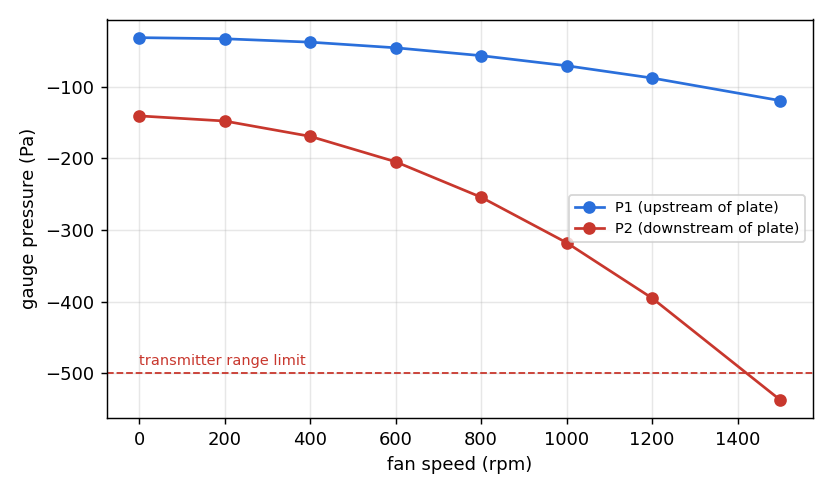
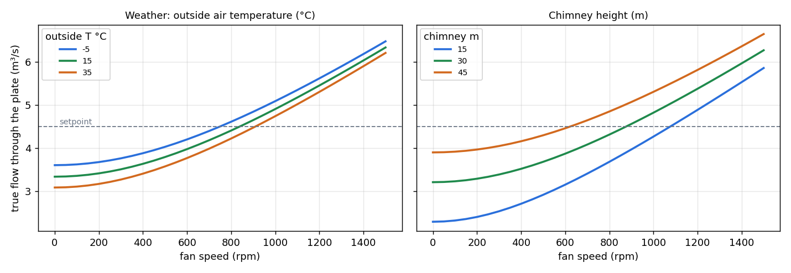
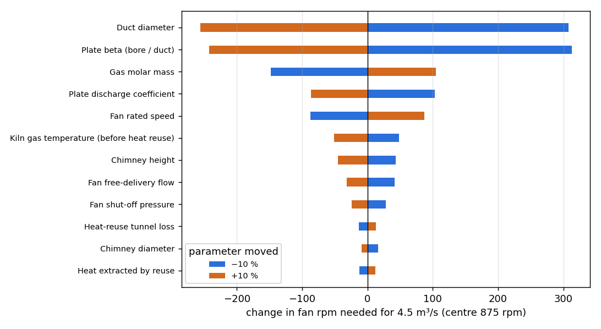
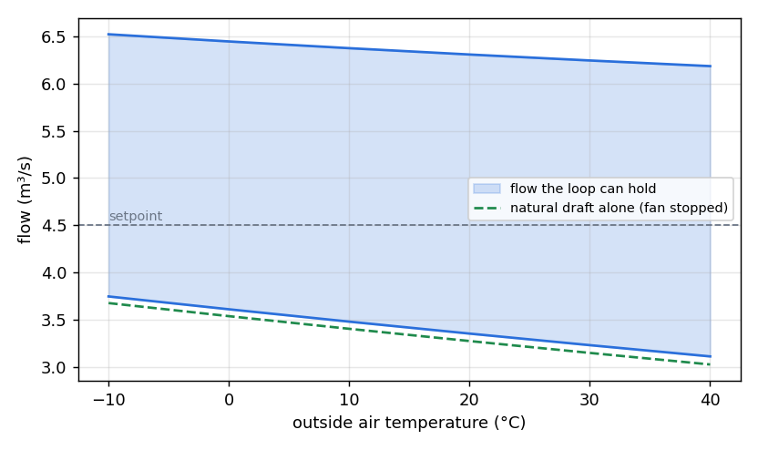

# How the parameters affect each other — kiln process simulation report

Generated 2026-11-14 by `python -m sim.report` from the simulation in `sim/` (model of natural draft,
chimney, orifice plate and fan, with the real `fan-ctrl` PID in a closed loop). Rerun it after changing the model or
the defaults and the numbers below update.

> **Read this first.** Every parameter value is a **placeholder** ("generally meaningful"), not site data. Trust the
> **directions, the relative sizes and the interactions**; do not quote the absolute numbers (flows, pressures, rpm) as
> predictions for the real kiln. §8 lists what the model leaves out.

## 1. The system being modelled

The heat reuse happens **inside the kiln's own tunnels, before the plate** (owner correction, 2026-11-14), so the plate
and the fan see gas that has already been cooled:

```
 kiln firing zone ─► heat-reuse tunnels ─► duct ─► ORIFICE PLATE ─► fan ─► chimney ─► outside air
 (T_kiln)            (gas cooled, loss       (loss)   P1 | P2, T        (adds     (buoyancy =
                      shows up in P1)                                    pressure)  natural draft)
```

Default operating point (all sliders at their defaults): kiln gas 250 °C leaving the firing zone, 25 °C outside,
20 % of the heat taken out by the tunnels so the plate sees 205 °C.
**Natural draft alone moves 3.21 m³/s** (129 Pa of draft). The fan, between its minimum
(200 rpm) and maximum (1500 rpm) speed, lets the loop hold anything from
**3.29 to 6.28 m³/s**. The default setpoint of 4.5 m³/s needs about **875 rpm**.

## 2. How the pieces connect

```
 outside T ─────────────────────────────┐
 kiln T ─► reuse extraction ─► T at plate ─► chimney mean T ─► DRAFT ──────┐
 chimney height / diameter / wall loss ──┘        ▲                       │
                                                  │ (more flow = less      ▼
 gas molar mass ─► gas density ─────────────► cooling in chimney)   TOTAL PUSH = draft + fan gain ──► FLOW
                                                                          ▲                          │
 fan rpm ─► fan gain (∝ rpm², fan curve) ────────────────────────────────┘                          ▼
                                                                                           plate ΔP ∝ flow²
 resistances: reuse tunnels, duct, plate (permanent loss), chimney, idle fan ─► divide the push           │
                                                                                         P1, P2 ─► counts ─► controller's flow estimate
 plate Cd / assumed Cd, assumed gas molar mass ───────────────────────────────────────────────────────────► (can be wrong) ─► PID ─► rpm
```

The model finds the flow from one pressure balance: **flow = √(total push ÷ total resistance)**. Four consequences
explain almost everything below:

1. **The fan and the draft add as pressures, but flow goes as a square root.** The more draft there already is, the less
   extra flow the same fan speed buys (§5.1).
2. **Resistance goes as 1/diameter⁴**, so the duct diameter and the plate bore dominate (§4).
3. **The plate signal is ΔP ∝ flow²**, so the instrument sees less at low flow and the resolution gets coarse (§5.5).
4. **The controller never sees the true flow**, only an estimate built from P1, P2, T and *assumed* Cd and gas molar mass.
   Whatever those assumptions get wrong becomes a true-flow error (§5.6).

| Parameter group | Changes the draft | Changes the resistance | Changes the fan's push | Changes what the controller sees | Changes timing |
|---|---|---|---|---|---|
| Weather (outside T, pressure) | ✔ (density difference) | – | – | – | – |
| Kiln gas T, reuse extraction | ✔ (gas lightness) | – | – | ✔ (T at the plate) | slow thermal lag |
| Gas molar mass, specific heat | ✔ | – | ✔ (density) | ✔ (density in the flow equation) | – |
| Reuse tunnel loss, duct, plate β | – | ✔ | – | ✔ (P1/P2 levels, ΔP signal) | – |
| Chimney height/diameter/friction/wall loss | ✔ | ✔ | – | – | – |
| Fan curve (shut-off ΔP, free-delivery flow, rated rpm) | – | ✔ (idle fan) | ✔ | – | – |
| Transmitter range, noise, lag, drift | – | – | – | ✔ | ✔ |
| PID gains, scan, ranges, anti-windup | – | – | ✔ (what rpm is asked for) | – | ✔ |

## 3. Baseline: what the fan does across its range

| fan rpm | flow m³/s | draft Pa | fan adds Pa | plate ΔP Pa | P1 Pa | P2 Pa | P2 vs ±range |
|---|---|---|---|---|---|---|---|
| 0 | 3.21 | 129 | -26 | 109 | -31 | -141 | 28 % |
| 200 | 3.29 | 129 | -21 | 115 | -33 | -148 | 30 % |
| 400 | 3.52 | 130 | -5 | 132 | -37 | -169 | 34 % |
| 600 | 3.87 | 130 | 20 | 159 | -45 | -205 | 41 % |
| 800 | 4.31 | 131 | 56 | 198 | -56 | -254 | 51 % |
| 1000 | 4.82 | 131 | 103 | 247 | -70 | -318 | 64 % |
| 1200 | 5.38 | 131 | 159 | 308 | -88 | -395 | 79 % |
| 1500 | 6.28 | 132 | 264 | 419 | -119 | -538 | 108 % |



* Flow rises from 3.21 to 6.28 m³/s over the fan's range, but **not in proportion to rpm** —
  the draft is a fixed head start (it barely moves: 129 → 132 Pa, only because the faster gas
  cools less in the chimney).
* A stopped fan is a small restriction (-26 Pa), not a blockage, so natural draft still flows.
* **At 1500 rpm the downstream pressure P2 is -538 Pa, 108 % of the placeholder
  ±500 Pa transmitter range**: the P2 transmitter would saturate at the fan's top speed. The transmitter range,
  the plate β and the fan size have to be chosen together (§5.5).



## 4. Which parameters matter most

Two views, because "which matters" depends on how you compare. The **relative** view moves each parameter by ±10 % of its
*own value* (physics only); the **slider-travel** view moves each slider by ±10 % of its *range* (what you feel when
dragging in the GUI). Output shown: the fan speed needed to hold 4.5 m³/s (centre: 875 rpm), plus the
natural-draft-only flow and the flow at a fixed 900 rpm.

**±10 % of each parameter's own value**

| Parameter | −10 % → +10 % | natural flow m³/s | flow at 900 rpm m³/s | rpm for 4.5 |
|---|---|---|---|---|
| Duct diameter | 0.9 m → 1.1 m | 2.70 → 3.70 | 3.85 → 5.25 | 1183 → 619 |
| Plate beta (bore / duct) | 0.54 → 0.66 | 2.69 → 3.67 | 3.84 → 5.21 | 1188 → 633 |
| Gas molar mass | 25.6 g/mol → 31.4 g/mol | 3.66 → 2.78 | 4.89 → 4.28 | 727 → 980 |
| Plate discharge coefficient | 0.55 → 0.671 | 3.03 → 3.37 | 4.31 → 4.79 | 978 → 789 |
| Fan rated speed | 1350 rpm → 1650 rpm | 3.21 → 3.21 | 4.82 → 4.36 | 788 → 963 |
| Kiln gas temperature (before heat reuse) | 225 degC → 275 degC | 3.03 → 3.38 | 4.44 → 4.68 | 924 → 824 |
| Chimney height | 27 m → 33 m | 3.05 → 3.36 | 4.45 → 4.67 | 919 → 830 |
| Fan free-delivery flow | 10.8 m3/s → 13.2 m3/s | 3.13 → 3.27 | 4.46 → 4.64 | 917 → 843 |
| Fan shut-off pressure | 540 Pa → 660 Pa | 3.24 → 3.18 | 4.49 → 4.63 | 904 → 852 |
| Heat-reuse tunnel loss | 2.7 → 3.3 | 3.23 → 3.18 | 4.60 → 4.53 | 862 → 889 |
| Chimney diameter | 1.08 m → 1.32 m | 3.18 → 3.22 | 4.52 → 4.59 | 891 → 867 |
| Heat extracted by reuse | 0.18 fraction → 0.22 fraction | 3.25 → 3.17 | 4.59 → 4.53 | 863 → 887 |
| Ambient temperature | 22.5 degC → 27.5 degC | 3.24 → 3.18 | 4.58 → 4.54 | 866 → 884 |
| Duct loss (kiln exit to plate) | 1.8 → 2.2 | 3.22 → 3.19 | 4.58 → 4.54 | 867 → 884 |
| Gas specific heat | 990 J/kg/K → 1210 J/kg/K | 3.20 → 3.21 | 4.56 → 4.57 | 877 → 874 |
| Chimney wall heat loss | 2.7 W/m2/K → 3.3 W/m2/K | 3.21 → 3.20 | 4.57 → 4.56 | 874 → 877 |
| Chimney friction factor | 0.018 → 0.022 | 3.21 → 3.21 | 4.56 → 4.56 | 874 → 876 |
| Atmospheric pressure | 95000 Pa → 105000 Pa | 3.20 → 3.21 | 4.56 → 4.56 | 876 → 875 |



**±10 % of each slider's travel** (depends on the slider ranges, which are my choice)

| Parameter | moved to | natural flow m³/s | flow at 900 rpm m³/s | rpm for 4.5 |
|---|---|---|---|---|
| Duct diameter | 0.9 m → 1.1 m | 2.70 → 3.70 | 3.85 → 5.25 | 1183 → 619 |
| Plate beta (bore / duct) | 0.555 → 0.645 | 2.82 → 3.56 | 4.02 → 5.06 | 1102 → 689 |
| Fan rated speed | 1300 rpm → 1700 rpm | 3.21 → 3.21 | 4.93 → 4.30 | 759 → 992 |
| Kiln gas temperature (before heat reuse) | 202 degC → 298 degC | 2.85 → 3.53 | 4.32 → 4.79 | 966 → 774 |
| Fan free-delivery flow | 9.4 m3/s → 14.6 m3/s | 3.02 → 3.32 | 4.30 → 4.72 | 983 → 815 |
| Chimney height | 24.5 m → 35.5 m | 2.91 → 3.48 | 4.36 → 4.76 | 953 → 791 |
| Heat-reuse tunnel loss | 1.5 → 4.5 | 3.34 → 3.09 | 4.74 → 4.40 | 806 → 939 |
| Fan shut-off pressure | 460 Pa → 740 Pa | 3.29 → 3.13 | 4.39 → 4.71 | 950 → 825 |
| Duct loss (kiln exit to plate) | 1 → 3 | 3.29 → 3.13 | 4.67 → 4.46 | 832 → 917 |
| Heat extracted by reuse | 0.14 fraction → 0.26 fraction | 3.33 → 3.08 | 4.65 → 4.47 | 839 → 911 |
| Gas molar mass | 27.7 g/mol → 29.3 g/mol | 3.33 → 3.09 | 4.65 → 4.48 | 839 → 908 |
| Plate discharge coefficient | 0.595 → 0.625 | 3.17 → 3.25 | 4.50 → 4.62 | 899 → 853 |
| Chimney diameter | 1 m → 1.4 m | 3.15 → 3.22 | 4.48 → 4.59 | 909 → 863 |
| Ambient temperature | 19.5 degC → 30.5 degC | 3.28 → 3.14 | 4.61 → 4.51 | 855 → 894 |
| Chimney wall heat loss | 1.5 W/m2/K → 4.5 W/m2/K | 3.24 → 3.18 | 4.58 → 4.55 | 869 → 882 |
| Chimney friction factor | 0.0145 → 0.0255 | 3.21 → 3.20 | 4.57 → 4.56 | 873 → 878 |
| Gas specific heat | 1060 J/kg/K → 1140 J/kg/K | 3.21 → 3.21 | 4.56 → 4.56 | 876 → 875 |
| Atmospheric pressure | 100325 Pa → 102325 Pa | 3.21 → 3.21 | 4.56 → 4.56 | 876 → 875 |
| Kiln gauge pressure | -10 Pa → 10 Pa | 3.21 → 3.21 | 4.56 → 4.56 | 875 → 875 |

What stands out (relative view):

* **Geometry dominates.** Duct diameter and Plate beta (bore / duct) are the top two: a 10 % change moves the rpm
  needed by roughly 564 rpm. That is the 1/diameter⁴ effect.
  They are fixed by the installation, but they are also the parameters you can check on site with a tape measure.
* **Gas molar mass is the biggest thing nobody controls.** It moves the rpm needed by
  253 rpm for ±10 % (wood moisture and
  firing stage change the flue-gas composition), through both the draft (density) and the controller's estimate.
* **Temperatures matter less than intuition says:** ±10 % of kiln temperature (±25 K) and ±10 % of ambient (±2.5 K)
  move the rpm needed by 100
  and 18 rpm. Weather is a small disturbance here (but see §5.2 for big swings).
* **Almost no effect:** atmospheric pressure, kiln gauge pressure, gas specific heat and chimney friction/wall loss
  (within ±10 %). Atmospheric pressure and kiln gauge pressure only shift P1/P2 levels; the flow does not change.

## 5. How parameters interact

### 5.1 The fan matters less when the draft is strong

Same fan move (0 → 900 rpm) in different weather and chimney heights:

| outside T °C | chimney m | draft Pa | flow, fan stopped m³/s | flow at 900 rpm m³/s | fan adds m³/s |
|---|---|---|---|---|---|
| -5 | 15 | 84 | 2.57 | 4.13 | 1.57 |
| -5 | 30 | 165 | 3.60 | 4.85 | 1.24 |
| -5 | 45 | 246 | 4.39 | 5.45 | 1.07 |
| 15 | 15 | 71 | 2.38 | 4.02 | 1.64 |
| 15 | 30 | 140 | 3.34 | 4.65 | 1.32 |
| 15 | 45 | 209 | 4.06 | 5.19 | 1.14 |
| 35 | 15 | 60 | 2.20 | 3.92 | 1.72 |
| 35 | 30 | 119 | 3.08 | 4.48 | 1.39 |
| 35 | 45 | 177 | 3.75 | 4.96 | 1.21 |

The fan adds **1.07–1.72 m³/s** depending on the draft already there: 1.72 m³/s at the weakest draft
(60 Pa) but only 1.07 m³/s at the strongest (246 Pa). Reason: flow ∝ √(draft + fan push), so each extra pascal of
fan push buys less flow when the total is already large. **The loop gain of the fan therefore changes with the weather and
the kiln temperature** — a fixed tuning is a compromise (it does cope here, §6).

### 5.2 Weather × kiln temperature decide how hard the fan works

Fan rpm needed to hold 4.5 m³/s:

| outside T °C ↓ / kiln gas °C → | 150 | 200 | 250 | 300 | 350 | 400 |
|---|---|---|---|---|---|---|
| -10 | 957 | 848 | 722 | 568 | 352 | 0 |
| 0 | 989 | 888 | 773 | 638 | 464 | 157 |
| 10 | 1018 | 923 | 818 | 696 | 549 | 342 |
| 20 | 1043 | 955 | 857 | 747 | 617 | 450 |
| 30 | 1067 | 984 | 893 | 791 | 674 | 532 |
| 40 | 1088 | 1010 | 924 | 830 | 723 | 598 |


The required speed runs from 0 rpm (cold air, hot kiln) to 1088 rpm (warm air, cool kiln). In the
corner with cold air and a very hot kiln the draft alone exceeds the setpoint and the fan can stop (0 rpm); if `motor_min_rpm` > 0 the fan
would run anyway and the flow would sit above the setpoint. Kiln temperature moves the answer more than weather does across these ranges
(a 250 K kiln swing against a 50 K weather swing), but both matter.

### 5.3 There is a minimum flow the loop cannot go below

The fan can add flow but cannot brake it. The lowest flow the loop can hold is what natural draft gives at the fan's
minimum speed, and it rises in cold weather:

| outside T °C | natural draft alone m³/s | lowest holdable (fan at 200 rpm) m³/s | highest holdable (fan at 1500 rpm) m³/s |
|---|---|---|---|
| -10 | 3.67 | 3.74 | 6.52 |
| 0 | 3.54 | 3.61 | 6.45 |
| 10 | 3.40 | 3.48 | 6.37 |
| 20 | 3.27 | 3.35 | 6.31 |
| 30 | 3.15 | 3.23 | 6.24 |
| 40 | 3.02 | 3.11 | 6.18 |



A setpoint below the "lowest holdable" line is simply unreachable with the fan alone: the PID pins the fan at minimum and the
flow stays above the setpoint (you can see this in the GUI by raising chimney height and lowering outside temperature). Holding lower flows would need a
damper. The envelope also tells you which setpoints are realistic in each season.

### 5.4 Heat reuse (inside the kiln) interacts with the draft, the pressures and the measurement

Two separate effects of the reuse tunnels, plotted as extraction (how much heat is taken) × tunnel loss (how much they resist):

| heat extracted | tunnel loss K | T at plate °C | natural flow m³/s | flow at 900 rpm | P1 Pa | plate ΔP Pa | rpm for 4.5 |
|---|---|---|---|---|---|---|---|
| 0 % | 0 | 250 | 3.89 | 5.24 | -30 | 266 | 580 |
| 0 % | 3 | 250 | 3.60 | 4.85 | -63 | 229 | 747 |
| 0 % | 9 | 250 | 3.17 | 4.28 | -108 | 178 | 1001 |
| 20 % | 0 | 205 | 3.48 | 4.94 | -29 | 260 | 731 |
| 20 % | 3 | 205 | 3.21 | 4.56 | -63 | 221 | 875 |
| 20 % | 9 | 205 | 2.81 | 4.01 | -108 | 171 | 1109 |
| 40 % | 0 | 160 | 3.02 | 4.63 | -28 | 251 | 855 |
| 40 % | 3 | 160 | 2.77 | 4.26 | -63 | 213 | 988 |
| 40 % | 9 | 160 | 2.42 | 3.72 | -107 | 162 | 1211 |

* **Extraction cools the gas** → the buoyancy advantage over the outside air shrinks → less draft. 0 % → 40 % extraction (tunnel loss 3) moves the natural flow
  3.60 → 2.77 m³/s and the rpm needed 747 → 988.
* **Tunnel loss is pure resistance** → less flow for the same push, and because it sits *before* the plate it deepens the suction at
  **P1 and P2 together** (-29 → -108 Pa at P1) while the plate ΔP only changes through the lower flow.
* The two **compound**: the worst corner (40 % extraction, loss 9) needs 1211 rpm against 580 rpm for no reuse.
* Practical consequence: **anything that changes the reuse (a damper, a different stage in use, fouling of the tunnels) changes
  the flow and the P1/P2 levels at the same fan speed, even though nothing changed at the plate.** The PID has to absorb it, and a
  sudden P1/P2 shift with no change in ΔP is a clue that the cause is upstream.

### 5.5 Plate bore, transmitter range and flow resolution

A smaller bore (lower β) gives a stronger plate signal but costs fan work and pushes the pressures out of the transmitter range:

| plate β | rpm for 4.5 | plate ΔP Pa | P2 Pa | P2 vs ±range | ΔP expressed in PLC counts (full scale 6000) | flow resolution % per count |
|---|---|---|---|---|---|---|
| 0.40 | 2484 (> motor max) | 1220 | -1281 | 256 % | 7318 | 0.007 |
| 0.50 | 1455 | 481 | -542 | 108 % | 2884 | 0.017 |
| 0.60 | 875 | 215 | -276 | 55 % | 1291 | 0.039 |
| 0.70 | 498 | 101 | -163 | 33 % | 608 | 0.082 |

* β is a three-way trade: **signal strength** (resolution per count), **fan work** (rpm needed), and **transmitter headroom**
  (P2 versus the range). At β = 0.4 the signal is huge but the fan cannot reach the setpoint and P2 is 256 % of the range; at
  β = 0.7 the fan hardly works but each PLC count is 2.1× coarser than at β = 0.6.

The square-root law also makes the resolution depend on the flow itself (default plate and range):

| flow m³/s | plate ΔP Pa | ΔP counts | flow resolution % per count | can the loop hold it? |
|---|---|---|---|---|
| 1.5 | 24 | 143 | 0.349 | no (outside the envelope) |
| 2.5 | 66 | 399 | 0.125 | no (outside the envelope) |
| 3.5 | 130 | 781 | 0.064 | yes |
| 4.5 | 215 | 1291 | 0.039 | yes |
| 5.5 | 321 | 1929 | 0.026 | yes |

Across the flows the loop can actually hold, one count is a 2.5× bigger slice of the flow at 3.5 m³/s than at
5.5 m³/s (0.064 % against 0.026 % per count). With the placeholder range that is fine; on the real transmitters a range
chosen for the top of the fan's range may leave too little resolution at the low end.

### 5.6 What measurement errors do to the TRUE flow

The controller adjusts the fan until *its estimate* equals the setpoint (4.5 m³/s). If the estimate is wrong the true flow ends up elsewhere.

True flow when the controller thinks it holds 4.5 m³/s:

| assumed Cd error ↓ / assumed gas molar mass → | 26.0 g/mol | 28.5 g/mol | 31.0 g/mol |
|---|---|---|---|
| -5 % | 4.52 | 4.74 | 4.94 |
| +0 % | 4.30 | 4.50 | 4.69 |
| +5 % | 4.09 | 4.29 | 4.47 |
| +10 % | 3.91 | 4.09 | 4.27 |

* The true gas is 28.5 g/mol. Assuming it is heavier than it is (31) makes the true flow **+4.3 %**; lighter (26) gives
  **-4.5 %**. Believing the plate Cd is 5 % higher than it is gives **-4.8 %**. These errors are *invisible to the controller*:
  it always reports "on setpoint".

Transmitter drift (offset added to one reading), true flow when the controller holds 4.5:

| drift (Pa or °C) | P1 reads high by | P2 reads high by | temperature reads high by |
|---|---|---|---|
| -30 | 4.80 | 4.17 | 4.65 |
| -10 | 4.60 | 4.39 | 4.55 |
| +10 | 4.39 | 4.60 | 4.45 |
| +30 | 4.17 | 4.80 | 4.37 |

* **P1 and P2 drift in opposite senses**, because only their difference counts: P2 reading 10 Pa high gives 4.60 m³/s
  (+2.3 %); the same drift on P1 gives the opposite error. A common-mode drift of both cancels. With a ΔP of ~221 Pa at this flow,
  a 10 Pa error is a ~2 % flow error (half the ΔP error, from the square root).
* **Temperature drift matters least**: +30 K → -3.0 % flow (only the gas density in the flow equation depends on it).

## 6. How the control loop behaves

Closed loop with the real `PIDController` (parallel form: `kp·e + ki·∫e + kd·de/dt`, output 0–100 % of the PID speed range).
Setpoint step 4.0 → 5.0 m³/s, no sensor noise, settling = within 2 % of the final value:

| Kp ↓ / Ki → | Ki 0.05 | Ki 0.2 | Ki 0.5 |
|---|---|---|---|
| Kp 0.5 | settle 116 s, overshoot 0.0 % | settle 23 s, overshoot 0.1 % | settle 20 s, overshoot 23.0 % |
| Kp 1.5 | settle 138 s, overshoot 0.0 % | settle 29 s, overshoot 0.1 % | settle 8 s, overshoot 9.3 % |
| Kp 3.0 | settle 161 s, overshoot 0.0 % | settle 34 s, overshoot 0.1 % | settle 6 s, overshoot 9.2 % |


* **At low and moderate Ki, Ki sets the speed and more Kp makes the final approach slower, not faster.** With this fast plant (gas lag a few seconds) the
  proportional term does most of the job at once and the integral finishes it; the effective integral speed is about Ki ÷ (1 + Kp·plant gain),
  so at Ki 0.05 settling goes 116 s → 138 s → 161 s as Kp rises 0.5 → 1.5 → 3. At high Ki (0.5) the loop
  rings and more Kp damps it instead: overshoot 23 % → 9 %. This is a property of the
  parallel form used here; the PLC's PID (PIDAT, 2-DOF with a proportional band) will not behave identically, so any tuning found here is a starting
  point for the PLC, not a copy (open item in `TODO.md`).
* The default Kp 1.5, Ki 0.2 settles in 29 s with 0.1 % overshoot: deliberately conservative.
  Ki 0.5 is faster (8 s) but overshoots 9 %.

How the **time constants** of the plant, motor, sensors and scan limit the loop (default gains):

| parameter | value s | settling | overshoot |
|---|---|---|---|
| Gas flow lag | 1.0 | 32 s | 0.1 % |
| Gas flow lag | 3.0 | 29 s | 0.1 % |
| Gas flow lag | 10.0 | 23 s | 1.6 % |
| Gas flow lag | 30.0 | 80 s | 22.2 % |
| Motor/fan lag | 0.5 | 31 s | 0.1 % |
| Motor/fan lag | 2.0 | 29 s | 0.1 % |
| Motor/fan lag | 8.0 | 21 s | 0.4 % |
| Motor/fan lag | 20.0 | 65 s | 18.4 % |
| Sensor lag | 0.5 | 30 s | 0.1 % |
| Sensor lag | 1.0 | 29 s | 0.1 % |
| Sensor lag | 5.0 | 13 s | 0.1 % |
| Sensor lag | 10.0 | 30 s | 15.6 % |
| Scan interval | 0.5 | 29 s | 0.1 % |
| Scan interval | 1.0 | 29 s | 0.1 % |
| Scan interval | 2.0 | 30 s | 0.1 % |
| Scan interval | 5.0 | 30 s | 0.1 % |

* The loop stays stable in every case tested, and the scan interval (0.5–5 s) hardly matters. A moderate lag even makes the conservative default
  settle sooner (the controller over-drives a little), which is not a free improvement: overshoot appears once a lag reaches tens of seconds:
  gas flow lag 30 s → 22 % overshoot and 80 s settling;
  motor/fan lag 20 s → 18 % overshoot; sensor lag 10 s → 16 %.
  A large fan on a big inertia, or impulse lines choked with tar (slow sensors), are the realistic ways to get there.
* **Weather disturbance:** a cold front (outside 25 → 5 °C) lifts the natural flow to 3.47 m³/s; the loop moves the fan to 796 rpm. The true flow
  deviates at most 0.12 m³/s (2.8 %) and is back within 2 % after 10 s.
  With these placeholder numbers feed-forward on ambient temperature would add little (§7).
* **Saturation and windup:** after 10 minutes with the setpoint below what the fan can reach (fan pinned at minimum), the time to get back to a reachable setpoint is
  **8 s with anti-windup versus 1139 s without**. The real `PIDController` has no anti-windup of its own (the simulation adds it around it); the PLC's PID must have it, or the
  loop will sit wound-up for many minutes after a long saturation (cold nights, hot kiln, a closed damper).
* **Sensor faults** (covered by tests, not by a table): an open circuit (counts 8000) on P1, P2 or T drops the fan to the safe speed at once and the loop resumes bumplessly
  when repaired. A *stuck* signal looks healthy to the controller and is not detected — the flow error then grows with the real process.

## 7. What this suggests

1. **Measure these first on site** (largest effect on the answer, §4): duct diameter and plate bore (a tape measure), gas composition / molar mass (flue-gas analysis over a
   firing cycle), plate Cd (calibration or a reference measurement), gas temperature at the plate, chimney height.
2. **Check the transmitter range against the fan's top speed.** The placeholder shows P2 at 108 % of range at maximum rpm. Choose range, β and fan size together (§5.5).
3. **Decide the minimum fan speed deliberately.** It sets the lowest flow you can hold (§5.3). If the process needs lower flows in cold weather, plan a damper.
4. **Feed-forward on ambient temperature looks low priority** if the real plant resembles this model: the PID absorbs a 3 % transient and recovers in seconds. Revisit once real data exists.
5. **Make sure the PLC's PID has anti-windup and bumpless start** (§6). Without them a long saturation costs many minutes.
6. **Expect the same setting to behave differently in summer and winter** (the fan's loop gain changes by tens of percent with the draft, §5.1); tune at the awkward end.
7. **A drifting P1 or P2 is a flow error you cannot see**; a ΔP-based cross-check or periodic zero check on both transmitters is worth having (§5.6).

## 8. What the model leaves out

* All values are placeholders (§ top). Flows, pressures and rpm are illustrative.
* Incompressible pressure balance (plate ΔP is ~0.22 % of atmospheric); hydrostatic effects in horizontal ducts ignored.
* Heat reuse is a fixed extraction fraction and a fixed loss; in reality they depend on the stages in use and on fouling. Gas temperature at the plate follows the kiln with a first-order lag.
* A stopped fan is a passive restriction (no windmilling); flow never reverses (it stalls at zero).
* Gas composition is a single molar mass; no condensation, tar fouling, or moisture in the plate calculation.
* The controller's flow estimate is a clean orifice equation, **not** the legacy empirical `calc_pv` (its input units are unverified and its constants must not be touched).
* The PID is the textbook parallel form in `fan-ctrl/pid.py` with sim-side anti-windup and bumpless start; the PLC's PIDAT may differ.
* No PLC/HMI/drive communication delays, no heartbeat or fallback-table behaviour (planned in `TODO.md`).
* One kiln, one fan, one chimney, no interaction between several kilns or dampers.

## 9. Reproduce

```
.venv\Scripts\activate
python -m sim.report          # rewrites this file and the figures in project/simulation-report/
python -m sim.server          # the interactive GUI at http://127.0.0.1:5002
pytest tests/sim              # model, loop and API tests
```
