# Simulation walkthrough: what is on the screen and what it shows

**Date:** 2026-11-17. Screenshots were taken from the running simulation on the dev machine.
**Read this first:** the simulation uses **placeholder values**, except the chimney size given by the
owner and a few values tuned to one site reading. Trust directions and relative sizes. Do not quote
the numbers as predictions for the real kiln. Section 7 lists what is real and what is not.

Related documents: `project/simulation-report.md` (numbers and sensitivity tables),
`project/simulation-build-plan.md` (build stages and status).

---

## 1. How to run it

```
.venv\Scripts\activate
python -m sim.server
```

| Page | Address | Shows |
|---|---|---|
| Exhaust path | http://127.0.0.1:5002 | Kiln outlet, fan, orifice plate, chimney, sky, and the flow control loop |
| Whole kiln | http://127.0.0.1:5002/kiln | The ring of 60 fireboxes: fire, dampers, doors, fuel, temperatures |

Each page links to the other. Two optional settings can be added to the address:
`?theme=light` forces the light theme, and `?exaggerate=0` opens the exhaust page at true scale.

---

## 2. Exhaust path page

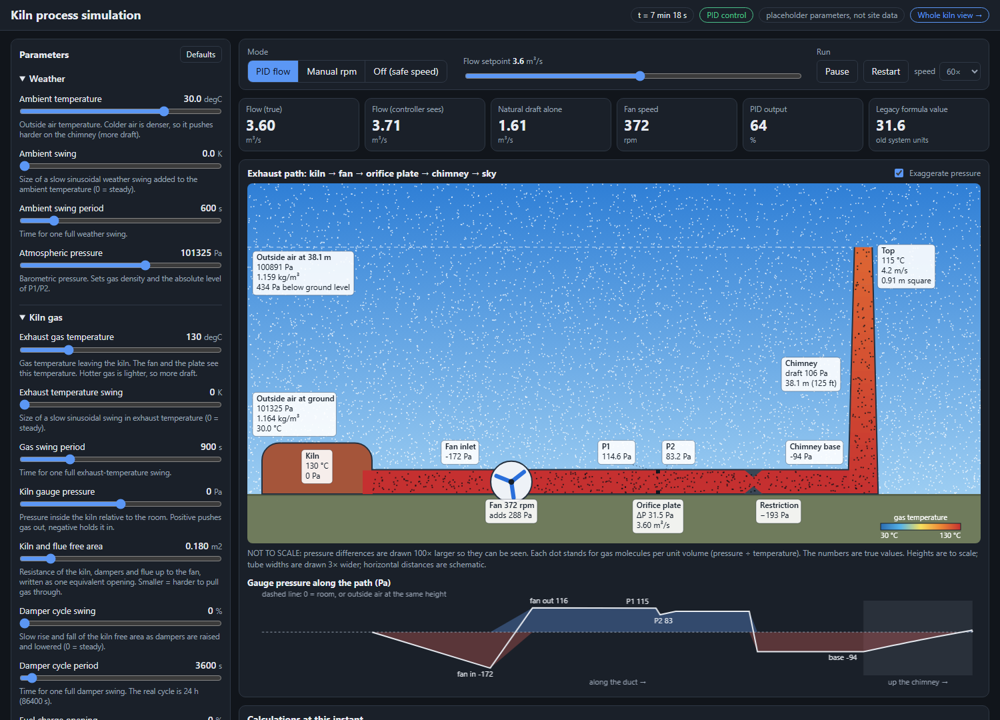

### 2.1 What is what

| Part of the screen | What it is |
|---|---|
| Left panel | Every model value as a slider, in groups (weather, kiln gas, duct, plate, fan, chimney, dynamics, instruments, controller). A dot marks a slider that is off its default |
| Mode | **PID flow**: the controller holds a flow setpoint. **Manual rpm**: fixed fan speed. **Off**: the fan goes to the safe speed; it does not stop |
| Six number tiles | True flow; the flow the controller calculates from P1, P2 and T; the flow natural draft would give with the fan stopped; fan speed; PID output; the legacy formula value |
| Picture | The gas path, drawn to height scale. See 2.2 |
| Pressure strip | Gauge pressure from the kiln to the chimney top. Red is suction, blue is pressure |
| Calculations | Pressure budget, velocities, densities, fan power, heat. See 2.4 |
| Sensor faults and drift | Break a transmitter (open circuit, stuck signal) or make it read high or low |
| History charts | Flow, fan speed, pressures, legacy formula value, temperatures |
| Status chip (top right) | Control mode, plus warnings: P1/P2 outside transmitter range, fan in the resonance band, sensor fault |

### 2.2 The picture

- **Tube colour is gas temperature.** Red is the exhaust temperature, shading to orange up the chimney
  as the gas cools. The legend at the bottom right gives the scale.
- **Dots are gas molecules per unit volume**, which is pressure divided by temperature. The same scale
  is used inside the tube and in the sky, so they can be compared by eye. Dots in the tube move at
  the gas velocity and speed up as the chimney narrows.
- **The sky** is the outside air. The labels give its pressure and density at the ground and at the
  height of the chimney top. At 38.1 m the air is 434 Pa below ground pressure.
- **The fan** turns at the shaft speed. The **orifice plate** is the pair of black bars; P1 is tapped
  before it and P2 after it. The **restriction** is the pinch after the plate (section 5, finding 2).
- **Labels** show true values at every station.

The "Exaggerate pressure" switch is on by default. Pressure differences in this system are less than
1 % of atmospheric, so at true scale they cannot be seen. With the switch on they are drawn 100 times
larger, and the note under the picture says NOT TO SCALE. The numbers are always true values.

With the switch off, only the temperature effect is visible: the hot gas in the tube is about a
quarter thinner than the outside air. That difference is what makes natural draft.

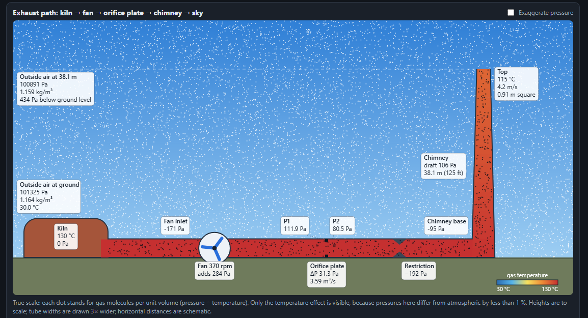

The light theme, for printing:

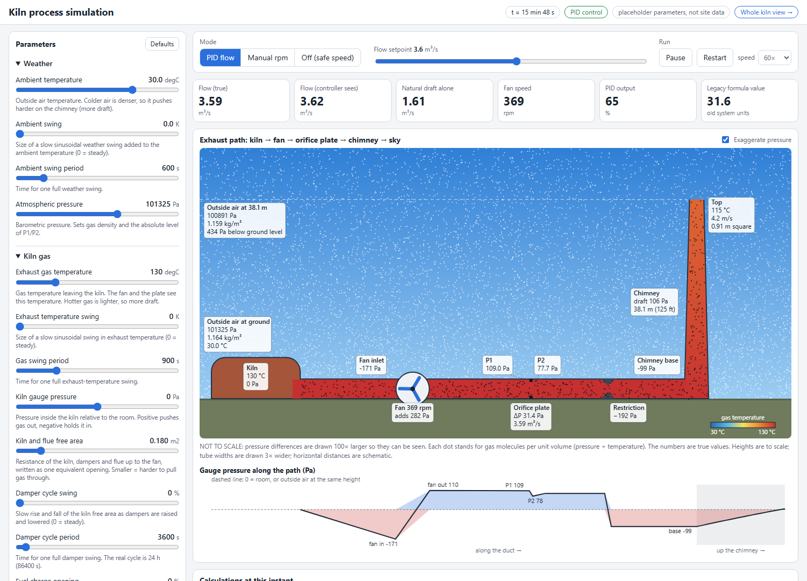

### 2.3 Reading the default case

PID mode, setpoint 3.6 m3/s, exhaust gas 130 degC, outside air 30 degC.

| Value | Screen | Meaning |
|---|---|---|
| Flow (true) | 3.6 m3/s | What passes the plate |
| Flow (controller sees) | 3.6 m3/s | Calculated from P1, P2 and T. Noisy, because the plate differential is small |
| Natural draft alone | 1.6 m3/s | Flow with the fan stopped |
| Fan speed | about 370 rpm | Site runs at 380 rpm |
| Fan inlet | -171 Pa | Suction that pulls gas through the kiln |
| Fan adds | about 283 Pa | |
| P1 / P2 | about 110 / 79 Pa | Site reading: 119.2 / 87 Pa at 380 rpm |
| Plate differential | 31 Pa | Site: 32.2 Pa |
| Restriction | -192 Pa | Loss after the plate (finding 2) |
| Chimney base | about -97 Pa | The chimney pulls |
| Chimney draft | 106 Pa | |
| Chimney top | 115 degC, 4.2 m/s | The gas cools 15 degC on the way up |

The pressure strip shows the same story left to right: suction grows to the fan inlet, the fan lifts
the pressure above zero, the plate takes a small step down, the restriction takes a large step down
into suction, and the chimney brings it back to zero at the top.

### 2.4 Calculations and charts

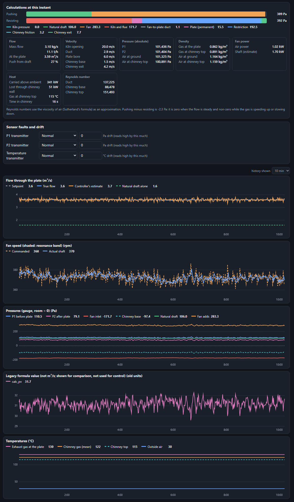

- **Pushing and resisting bars.** Natural draft (106 Pa) and the fan (283 Pa) push. The kiln and flues
  (172 Pa) and the restriction (193 Pa) take almost all of it. The plate costs 16 Pa and the whole
  chimney 11 Pa. The two bars are equal when the flow is steady.
- **Flow:** 3.1 kg/s, which is 11 tonnes of gas per hour. Draft supplies 27 % of the push.
- **Velocity:** 20 m/s through the kiln's equivalent opening, 2.9 m/s in the duct, 6 m/s through the
  plate bore, 1.5 m/s at the chimney base, 4.2 m/s at the exit.
- **Fan power:** about 1 kW of air power, about 1.7 kW at the shaft with the placeholder efficiency.
- **Heat:** the gas carries 341 kW above ambient and loses 51 kW through the chimney wall.
- **Legacy formula value chart:** about 31.7 in the old system's units. It is shown for comparison and
  is not used for control.

---

## 3. Scenarios on the exhaust path page

### 3.1 Fan slow: the transmitters go blind

Manual 100 rpm (minimum speed set to 0 for this test).

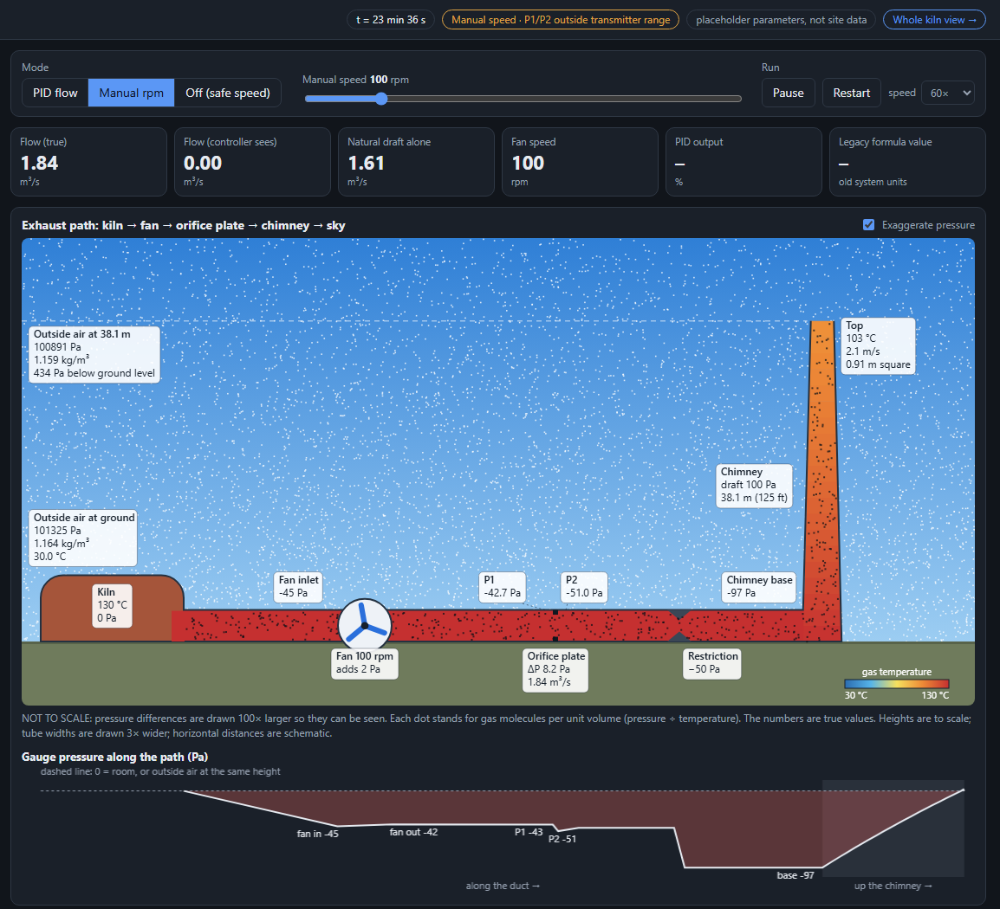

- True flow is 1.84 m3/s, mostly natural draft.
- The whole path is under suction. P1 is -43 Pa and P2 is -51 Pa.
- The site transmitters read 0 to 250 Pa only, so they cannot read suction. **The controller sees 0.00
  m3/s** and the legacy formula has no value.
- The status chip warns "P1/P2 outside transmitter range".
- The chimney gas cools more at low flow: 103 degC at the top.

### 3.2 Fan at maximum

Manual 450 rpm.

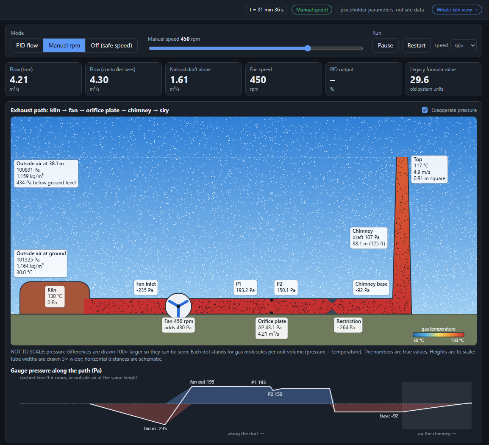

- True flow 4.21 m3/s. P1 is 193 Pa and P2 is 150 Pa, inside the 250 Pa range.
- Fan inlet suction is -235 Pa; the restriction takes 264 Pa.
- **The legacy formula value is 29.5, lower than the 31.6 it shows at 3.6 m3/s.** More flow, lower
  value (finding 4).

### 3.3 Fuel charges and damper movement

PID at 3.6 m3/s. The kiln opens 30 % wider for 60 s every 5 minutes (fuel charge) and its opening
swings by 15 % over 20 minutes (dampers). These sizes are guesses chosen to make the effect visible.

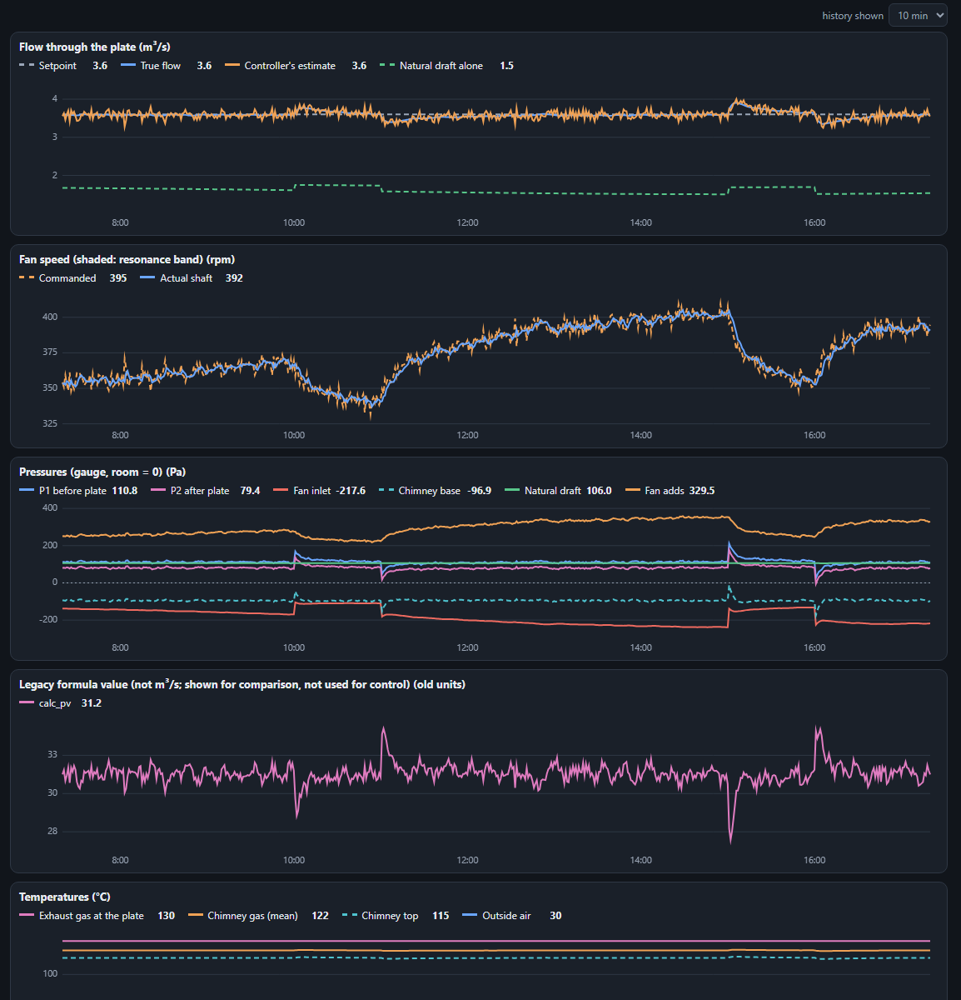

- Fan speed moves between 320 and 409 rpm to hold the flow.
- True flow stays between 3.35 and 3.91 m3/s. The spikes at each charge last a few seconds.
- Fan inlet suction moves from -110 to -230 Pa. P1 and P2 barely move, apart from the spikes.
- The legacy formula value jumps at each charge.

### 3.4 A transmitter that drifts

P2 made to read 5 Pa high.

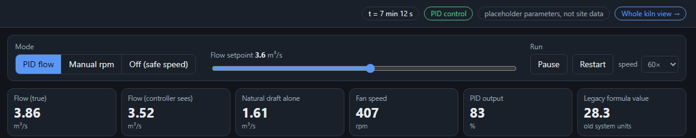

- The controller still reports its setpoint, about 3.6 m3/s.
- **The true flow is 3.84 m3/s, 7 % high.** The fan has gone from 370 to 407 rpm.
- Nothing on a real panel would show this. The plate differential is only about 31 Pa, so 5 Pa of
  drift is a large share of it.

---

## 4. Whole kiln page

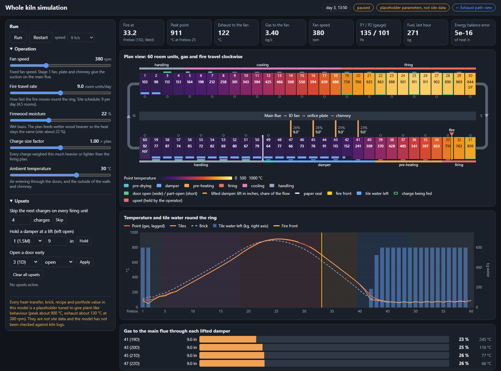

### 4.1 What is what

| Part of the screen | What it is |
|---|---|
| Run | Pause, restart and speed (up to 6 simulated hours per second) |
| Operation sliders | Fan speed, fire travel rate, firewood moisture, charge size, ambient temperature |
| Upsets | Skip the next charges on every firing unit; hold a damper open; open a door early; clear |
| Number tiles | Where the fire is, hottest point, exhaust temperature and flow to the fan, fan speed, P1/P2, fuel fed in the last hour, energy balance error |
| Plan view | The 60 room units. East battery 1-30 on top, west battery 31-60 below, joined by the north and south interconnecting flues. Gas and fire travel clockwise |
| Cell colour and number | Temperature at that firebox's measuring point |
| Coloured bars above and below the rows | Zone: handling, pre-drying, damper, pre-heating, firing, cooling |
| Orange stems to the main flue | Lifted dampers, with lift in inches and share of the gas |
| Blue bars in cells | Water left in the tiles |
| Green marks | Open or part-open doors |
| Yellow line and red triangle | The fire front |
| Ring chart | Point, tile and brick temperature against firebox number, with tile water as blue bars |
| Damper bars | Share of the gas through each lifted damper, and the gas temperature there |
| History charts | Exhaust temperature, flow, fan speed, P1 and P2, peak temperature, fuel fed per hour |

The same page in the light theme:

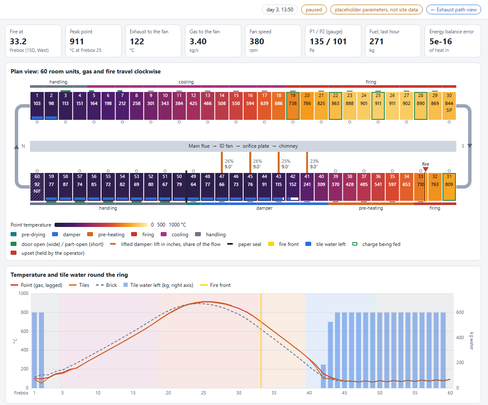

### 4.2 Reading the settled kiln

Fixed 380 rpm, schedule of 9 room units per day, after three and a half simulated days.

| Value | Screen |
|---|---|
| Fire front | Firebox 33 |
| Fireboxes firing | 15 (19 to 33) |
| Hottest point | 911 degC at firebox 25, about 8 units behind the fire front |
| Pre-heating zone | 653 degC falling to 370 degC over 6 units ahead of the fire |
| Tile water | All gone by about 8 units ahead of the fire |
| Cooling zone | 686 degC just behind the fire, falling to about 100 degC at the open doors |
| Lifted dampers | 41, 43, 45 and 47 at 9 in, each taking 23 to 26 % of the gas |
| Gas temperature at those dampers | 245, 116, 77 and 66 degC |
| Exhaust to the fan | 122 degC, 3.4 kg/s |
| P1 / P2 | 135 / 101 Pa |
| Fuel | 271 kg of firewood per hour, about 1,080 kW |

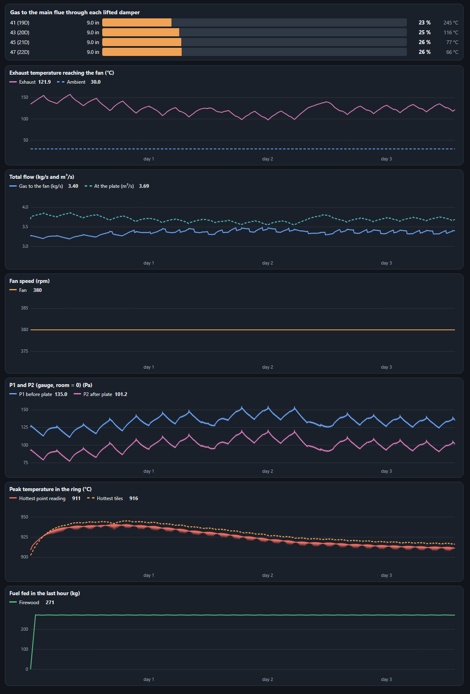

- **Exhaust temperature swings between about 100 and 150 degC** with a period of about 5 hours. That
  is the time between one damper starting to lift and the next. The damper nearest the fire takes
  the hottest gas; as it closes, the mix cools.
- **P1 and P2 swing by about 30 Pa** with the same rhythm at a fixed fan speed. A flow controller
  would have to follow this.
- The small steps every 15 minutes are the fuel charges.

### 4.3 Upset: four hours without fuel

Sixteen charges skipped on every firing unit.

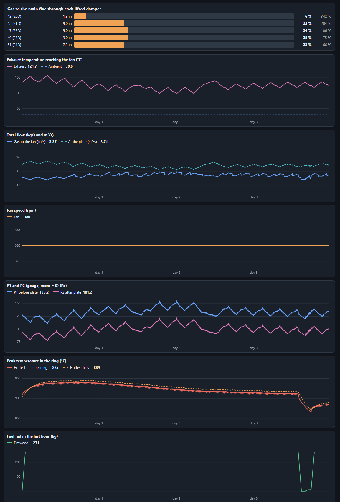

- Fuel fed drops to zero for four hours (bottom chart).
- The hottest point falls from about 915 to 865 degC, then starts to recover when feeding resumes.
  Five hours later it is back to 885 degC.
- The exhaust temperature, flow, P1 and P2 hardly change. **The fan end cannot see a missed firing
  for hours**; only the firebox temperatures show it.

---

## 5. Findings

Each finding comes from the model with placeholder values. Each needs a site check before it is
relied on.

1. **The default case lands close to the one real reading.** Site: P1 119.2 Pa, P2 87 Pa at 380 rpm
   and 130.4 degC. Model at the same speed and temperature: 121 and 88 Pa. This is a fit made by
   choosing four values, not a confirmation.
2. **About 200 Pa is lost after the plate that the chimney does not explain.** A 125 ft chimney at
   130 degC gives about 106 Pa of draft, so P2 should be about -115 Pa. The site shows +87 Pa. The
   chimney as given accounts for 11 Pa. The model carries the rest as a restriction equal to a
   0.17 m2 opening. Possible causes: 3 ft and 5 ft are outside dimensions (an inside top of about
   1.4 ft square would do it); a damper, bend or soot after the plate; strong cooling in the chimney;
   P2 tapped elsewhere.
3. **Flow cannot be measured below about 245 rpm.** P2 goes under suction there and a 0-250 Pa
   transmitter cannot read it. The controller then under-reads the flow and the fan hunts. The
   placeholder minimum speed of 220 rpm is inside that region.
4. **The legacy formula value depends on back-pressure, not only on flow.** In this model it peaks
   near 300 rpm and then falls as flow rises (31.6 at 3.6 m3/s, 29.5 at 4.2 m3/s). At the site
   reading the formula as coded gives 31.0; the old screen showed 40.33. The real system ran on this
   value for years, so either the real back-pressure behaves differently from the modelled
   restriction or the old inputs were not plain gauge pressures.
5. **A small transmitter drift is a large hidden flow error.** P2 reading 5 Pa high gives 7 % more
   true flow while the controller reports its setpoint.
6. **Natural draft alone moves about 1.6 m3/s**, close to half the setpoint. The fan cannot hold a
   flow below what draft gives.
7. **The kiln looks like a 0.18 m2 opening to the fan**, with four or five dampers each taking about
   a quarter of the gas. This came out the same from two directions: the stage 1 fit and the
   stage 2 ring model.
8. **The damper cycle disturbs the fan end every five hours or so.** Exhaust temperature moves by
   about 50 degC and P1/P2 by about 30 Pa at fixed fan speed.
9. **A missed firing does not show at the fan.** Four hours without fuel dropped the peak by 50 degC
   and left exhaust temperature and flow almost unchanged.
10. **At 480 rpm P1 reaches about 230 Pa** in the kiln model, close to the top of the 250 Pa
    transmitter range. The top fan speed and the transmitter range have to be chosen together.

---

## 6. What to do on site

| # | Action | Answers |
|---|---|---|
| 1 | Speed step test: five or six fan speeds, log rpm, P1, P2 and temperature at each | Findings 2, 3, 4; gives the fan-and-system curve |
| 2 | Confirm the chimney's inside dimensions and what sits between the plate and the chimney | Finding 2 |
| 3 | Get the fan curve or nameplate | The largest unknown in the model |
| 4 | Collect the LabVIEW minute logs (P1, P2, exhaust temperature, flow, rpm) | Findings 4 and 8; legacy formula tests |
| 5 | Export firebox temperatures and kiln events from VelKilnMaster | Checks the temperature wave in section 4 |
| 6 | Zero-check both pressure transmitters | Finding 5 |
| 7 | Decide the minimum and maximum fan speed against the transmitter range and the resonance band (150-210 rpm) | Findings 3 and 10 |

---

## 7. What is real and what is placeholder

| Item | Status |
|---|---|
| Chimney 125 ft, 5 ft square at the base, 3 ft at the top | Owner, 2026-11-16. Treated as inside dimensions (not confirmed) |
| Plate between the fan and the chimney | Owner, 2026-11-16 |
| P1 119.2 Pa, P2 87 Pa, 130.4 degC, 380 rpm | One LabVIEW screen reading, 17-03-2026 |
| Transmitters 0-250 Pa, resonance band 150-210 rpm | VelKilnMaster documents |
| 60 fireboxes, doors, dampers, schedule, 724 kg firewood per firebox | VelKilnMaster documents |
| Legacy formula and its constants | `fan-ctrl` code, used unchanged |
| Duct and plate size, fan curve, kiln opening, restriction | Chosen to reproduce the one reading |
| Brick mass, heat transfer values, wall loss | Tuned to give a peak near 900 degC and exhaust near 130 degC |
| Size of charge and damper disturbances on the exhaust page | Guesses |

---

## 8. Known weak points

- One operating point cannot fix four unknowns. A second and third reading would.
- Rooms in the handling zone stay at 75 to 150 degC in the kiln model, because their brick only cools
  through the wall. Real rooms must be cool enough to work in.
- Wall loss takes 45 % of the fuel heat in the kiln model. It is a tuned value.
- The kiln page runs at a fixed fan speed. The flow controller is not yet connected to it.
- Coal stages of the firing plan, top-open timing, cooling fans and the special damper rules at the
  interconnecting flues are not modelled.
- Screenshots were taken with a headless browser at 1500 px width. A phone-width window has not been
  checked.
